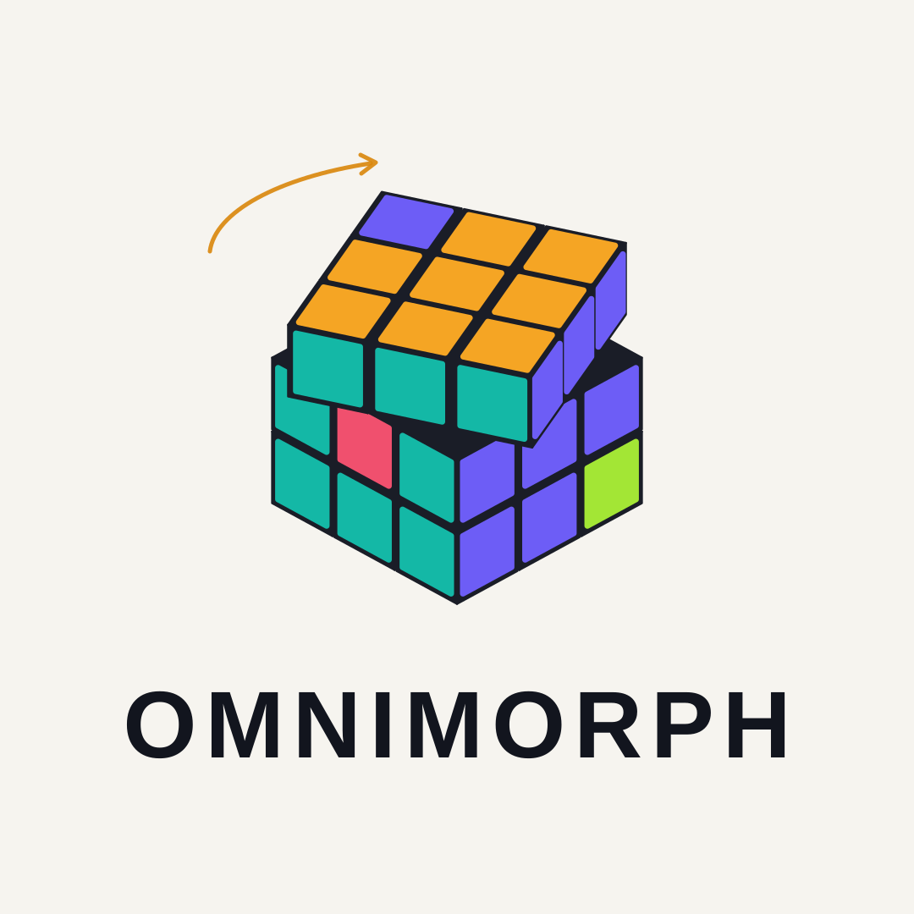
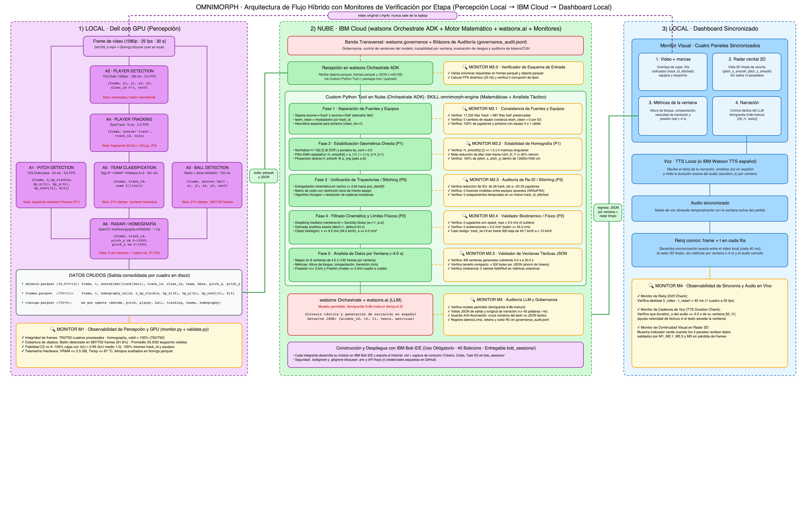
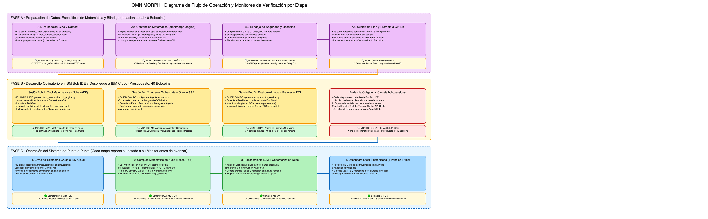

  

# ⚽ Omnimorph — Análisis Táctico y Narración Deportiva Sincronizada con IA

**IBM SkillsBuild AI Experiential Learning Lab | México 2026**

Bienvenido al repositorio oficial de **Omnimorph**, una plataforma híbrida de visión por computadora, modelado físico-matemático e inteligencia artificial generativa en **IBM Cloud (`watsonx Orchestrate ADK` + `watsonx.ai` + `watsonx.governance`)** que transforma clips de video *broadcast* de fútbol ($1080\text{p}$, $25\text{ fps}$, $30\text{ s}$) en telemetría 2D estabilizada, métricas tácticas colectivas y narración deportiva en español sincronizada en tiempo real.

---

## 🌿 Navegación por Ramas del Repositorio

Este repositorio está estructurado en **4 ramas especializadas** según el área de trabajo:

| Rama | Propósito Principal | Documentos Clave en la Rama |
| :--- | :--- | :--- |
| **`main`** *(Actual)* | **Bienvenida y Portada General:** Arquitectura global, mapa del proyecto, cumplimiento de licencias y carpeta obligatoria `bob_sessions/`. | [`README.md`](README.md), [`AGENTS.md`](AGENTS.md), [`bob_sessions/`](bob_sessions/) |
| **`investigacion`** | **Fórmulas y Modelos Matemáticos (`P1`, `P2`, `P3`):** Derivación teórica de homografías normalizadas, Algoritmo Húngaro, Savitzky-Golay y métricas tácticas. | [`investigacion/FORMULAS_Y_FUNDAMENTOS.md`](investigacion/FORMULAS_Y_FUNDAMENTOS.md), [`02_documentacion_omnimorph/SPEC_MOTOR_OMNIMORPH.md`](02_documentacion_omnimorph/SPEC_MOTOR_OMNIMORPH.md) |
| **`analisis`** | **Resultados Experimentales y Monitores (`M1`–`M4`):** Benchmarks de los 6 agentes en GPU, validación `C2 vs A` (`IoU = 1.0`) y semáforos de observabilidad. | [`analisis/RESULTADOS_Y_MONITORES.md`](analisis/RESULTADOS_Y_MONITORES.md), [`02_documentacion_omnimorph/REPORTE_TECNICO_GPU.md`](02_documentacion_omnimorph/REPORTE_TECNICO_GPU.md) |
| **`implementacion`** | **Lógica de Operación y Ejecución en IBM Bob IDE:** Código del motor para `watsonx Orchestrate ADK`, flujo de operación y prompts listos para **IBM Bob IDE**. | [`implementacion/cloud_tool/omnimorph_engine.py`](implementacion/cloud_tool/omnimorph_engine.py), [`implementacion/PROMPTS_IBM_BOB.md`](implementacion/PROMPTS_IBM_BOB.md) |

---

## 🏗️ Arquitectura de Flujo Híbrido con Monitores por Etapa (`M1` a `M4`)

1. **`1) LOCAL · Percepción GPU (Congelado en Disco)`:**
   - Ejecuta una sola vez los 6 agentes de visión (`A1` Pitch Detection, `A2` Player Detection, `A3` Ball Detection, `A4` ByteTrack, `A5` SigLIP+UMAP+KMeans, `A6` ViewTransformer) generando `frames.parquet` ($750$ filas) y `objects.parquet` ($35,870$ filas). Supervisado por **`MONITOR M1`**.
2. **`2) NUBE · IBM Cloud (`watsonx Orchestrate ADK` + `watsonx.ai` + `watsonx.governance`)`:**
   - **Custom Python Tool (`omnimorph-engine`):** Ejecuta en $<1.5\text{ s}$ de CPU en la nube las 5 fases matemáticas auditadas por los monitores **`M2.0` a `M2.5`**.
   - **Agente Táctico y Narrador (`ibm/granite-3-8b-instruct`):** Genera la crónica táctica y locución en español por cada ventana de $4.0\text{ s}$, auditada por **`MONITOR M3`** (`governance_audit.jsonl`).
3. **`3) LOCAL · Dashboard Sincronizado (4 Paneles + TTS)`:**
   - Sincroniza mediante el reloj común `(frame, t)` el Video con marcas, el Radar cenital 2D limpio, las Métricas de ventana y el Audio TTS en español, supervisado por **`MONITOR M4`**.

---

## 🔄 Diagrama de Flujo de Operación y Desarrollo en IBM Bob IDE

---

## ⚖️ Gobernanza, Seguridad y Cumplimiento de Licencias

* **Uso Obligatorio de IBM Bob IDE (`bob_sessions/`):** Todo el desarrollo de implementación se realiza en **IBM Bob IDE** dentro del presupuesto compartido de **40 Bobcoins**. Las exportaciones `.md` y capturas de consumo de cada integrante se almacenan en [`bob_sessions/`](bob_sessions/).
* **Protección de Credenciales:** Los archivos [`.gitignore`](.gitignore) y [`.bobignore`](.bobignore) bloquean estrictamente archivos `.env` y llaves de API de IBM Cloud.
* **Licencias de Código Abierto y Datos:**
  - Los modelos de detección de `ultralytics` (YOLOv8) se utilizan bajo licencia abierta **AGPL-3.0**; `google/siglip-base-patch16-224` bajo **Apache-2.0**; `roboflow/sports` y `supervision` bajo **MIT**.
  - Por respeto a los derechos de autor de transmisiones deportivas (*broadcast*), **ningún archivo de video `.mp4` se redistribuye en este repositorio público**; únicamente se procesan y comparten tablas numéricas de telemetría (`.parquet` y `.json`) con fines académicos y de investigación.
