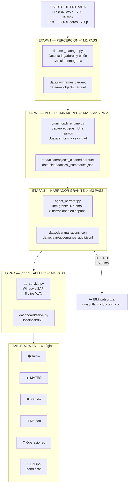

# /architect-brownfield Documenta el estado actual de Omnimorph en la rama feat-costa-rica, sin proponer cambios todavía. Es un plano para compartir con el equipo.

Antes de empezar, lee AGENTS.md, bob_sessions/README.md y las sesiones 20, 21 y 22.

Incluye:
1. Diagrama de la arquitectura: dataset → percepción → motor Omnimorph → narrador Granite → TTS → tablero web (dashboard/, puerto 8600).
2. Stack y dependencias reales, sacadas de los archivos del repo.
3. Mapa de carpetas y archivos clave, con una línea por cada uno.
4. Páginas de la web (Inicio, MATEO, Partido, Método, Operaciones, Equipo): qué muestra cada una y de qué JSON lee.
5. Monitores M1–M4: qué verifica cada uno y el último resultado, tomado de data/clean/.
6. Uso de IBM: watsonx.ai, Granite, Orchestrate y Bob.
7. Estado: qué funciona, qué espera validación de Fer y qué queda pendiente antes y después de la demo.

Guarda el plano en blueprints/estado_actual_2026-11-10.md. Escríbelo en español claro, para gente no técnica del equipo. No incluyas llaves, tokens ni el contenido de .env.

---

**Status:** active  **Date:** 2026-11-10

---

### 👤 User

---
name: architect-brownfield
description: >-
  Design a change against an existing codebase — maps the repo's stack,
  conventions, structure and tests, then emits a blueprint for a feature,
  refactor, or migration instead of a from-scratch build. / Diseña un cambio
  sobre un repo existente — mapea stack y convenciones y emite un blueprint de
  cambio, no de proyecto nuevo.
metadata:
  user-invocable: true
  disable-model-invocation: true
  argument-hint: '[what you want to change, add, or migrate]'
---

# `/architect-brownfield` — design a change to code that already exists

You are being invoked as `/architect-brownfield`. Most coding-agent work is not greenfield —
roughly a quarter of sessions write new code, and the rest modify what is already there. This is the
entry point for the rest.

Read the skill first — the phases, the shapes, and the acceptance-criteria contract are unchanged:

- Plugin install: `${CLAUDE_PLUGIN_ROOT}/skills/architect/SKILL.md`
- Clone install: `./CLAUDE.md` at the repo root — the clone-mode mirror of the skill. Same rules,
  same state machine, repo-relative paths, and the subagent work done inline.

## Mode

| Setting | Value |
|---|---|
| Entry | Existing repo in the cwd |
| Deliverable | A **change blueprint** — feature, refactor, integration, or migration |
| Shapes | Same files. They are stack-agnostic, so they describe a system that already exists just as well as one that does not. |
| Output | Bundle or single file — derived and announced at phase-4 Step 2 (12 or more steps = bundle); an explicit user preference wins. Both land under `./blueprints/` in the repo. |
| Gate | `blueprint-validator` must return **PASS** |

## Phase 0 — map the repo (this is the phase that does not exist in the greenfield flow)

Before any question, read the codebase. Do not ask the user what you can read.

| What | Where to look |
|---|---|
| Runtime track | Package manifest + lockfile, language version files, container base image |
| Framework and topology | Entry points, routing directory, server vs client split, workspace layout |
| Conventions | Naming, module boundaries, error handling, the linter/formatter config that is actually enforced |
| Data layer | Migrations directory, schema files, ORM usage sites |
| Test setup | Runner, where tests live, how they are named, what the coverage floor is if any |
| CI and deploy | Workflow files, deploy config, environment variable surface |
| Existing agent instructions | `CLAUDE.md` / `AGENTS.md` — these outrank the plugin's defaults |

Then print a **Repo Map**: track, framework, data layer, test command, lint command, build command,
deploy target, and the 3-5 conventions the change must respect. Ask the user to correct anything you
read wrong. Their correction is cheaper than your assumption.

## Phase 1-3 — compressed interview

Skip discovery of *what the product is* — the repo already answered that. Ask about the **delta**,
max 3 questions per message, using `${CLAUDE_PLUGIN_ROOT}/questions/phase-2-branches.md` and
`${CLAUDE_PLUGIN_ROOT}/questions/phase-3-confirmation.md` as the source:

1. What should be true after this change that is not true now?
2. What must keep working exactly as it does today?
3. What is off-limits — files, services, data, downtime windows?

Then present the change architecture for sign-off: the delta, the blast radius, the rollback.

## Phase 4 — the change blueprint

Compose from `${CLAUDE_PLUGIN_ROOT}/templates/blueprint-template.md`. **Brownfield gets no sections
of its own.** The template's 20 numbered sections are fixed and downstream tooling indexes them by
number, so brownfield content goes into existing sections as named subsections:

| Brownfield content | Goes in |
|---|---|
| **Current state** — the Repo Map plus the specific modules the change touches | §1 Project Overview, as a `### Current state` subsection |
| **Target state** — what the code looks like after, in the repo's own conventions | §1 Project Overview, as a `### Target state` subsection |
| **Delta** — files added, modified, deleted; named, not gestured at | §3 Directory Structure, §4 Data Model, §5 API Design — a `### Delta` subsection in each, covering only what that section owns |
| **Interfaces held constant** — public API surface, DB columns, events, env vars that must not move | §5 API Design, as an `### Interfaces held constant` subsection. Mirror each frozen interface as a row in §1 Non-Goals. |
| **Build order** | §9, unchanged. Same numbered one-sitting steps, each with an observable "Done when" and a verify command that runs against **this** repo's test setup. |
| **Parity and cutover** | **§9.1** — required when the change is a migration (see below) |
| **Rollback** | §12 Release and rollback, plus the per-step `Checkpoint` field in each §9 step |

**All 20 sections still appear.** A section with no brownfield content carries
`NOT APPLICABLE — <reason>` under its heading. Never delete a heading and never add a 21st.

Emit the canonical bundle (`${CLAUDE_PLUGIN_ROOT}/questions/phase-4-generate.md` Step 3 is the
authority on the tree):

```
./blueprints/<change-slug>/
├── blueprint.md          # the 20-section narrative
├── tasks.json            # ${CLAUDE_PLUGIN_ROOT}/templates/tasks-schema.md
├── epics/NN-<name>.md    # ${CLAUDE_PLUGIN_ROOT}/templates/epic-template.md
└── workspace/            # the builder copies this directory INTO the repo root
    ├── CLAUDE.md
    ├── AGENTS.md
    ├── .claude/{settings.json, skills/<name>/SKILL.md, rules/<name>.md}
    └── <verify-critical config>   # §19.6 — every config a §9 Verify needs, at its repo path
```

In a brownfield repo `workspace/CLAUDE.md` and `workspace/AGENTS.md` **merge into** the repo's
existing files rather than overwriting them — say so in the handoff. **Never emit
`.claude/commands/`**: a slash command only fires when a human types it, and an autonomous builder
types nothing. Repeatable project workflows go in `.claude/skills/<name>/SKILL.md`.

Single-file mode emits `./blueprints/<change-slug>-blueprint.md` with everything inline, no
`tasks.json` and no `epics/`. `/architect-next` needs the bundle; single file means resume is manual.
With a bundle, `/architect-next` works on it identically to a greenfield one.

## §9.1 Parity and cutover — required when the change is a migration

Rewrites die at cutover, not at design. Any migration — framework, database, provider, language —
gets **Section 9.1** or the validator fails it. Its six parts:

1. **Parity checklist** — every behavior the old path has, as a checkable row. Including the ones
   nobody documented; go read them out of the code.
2. **Parity harness** — the command that proves old and new agree. Golden outputs, shadow reads,
   recorded-request replay. Name the actual command.
3. **Coexistence** — how both paths run at once. Flag, router, dual-write. Include how you keep data
   consistent while both are live.
4. **Cutover sequence** — numbered, each with its own "Done when" and its own rollback. Every
   "Done when" here must be decidable by a script on this machine — a step that waits on a human
   approving the switch belongs in the post-build launch checklist, not in the build order.
5. **Kill criteria** — the observable signal that says roll back now, expressed as a threshold a
   query or an alert rule can evaluate, plus the person on watch.
6. **Decommission** — an owned item on the post-build launch checklist, with its precondition and a
   soak period that outlasts the build. Never a §9 step and never a `tasks.json` task: the build
   gate is full cutover with the old path still deployed and revertible.

## Rules

1. **Never propose a big-bang rewrite.** Incremental with a coexistence window, always.
2. **The repo's conventions beat the plugin's defaults.** Every time. If the repo does something you
   would not have chosen, match it and record the disagreement in §20.3 Decision log with its
   `Would reverse if` trigger — do not quietly introduce a second style, and never park an
   unresolved question in the deliverable.
3. **Pins come from the repo's lockfile,** not from the runtime track. Verify against the registry
   with `stack-researcher` before proposing any upgrade, and keep the upgrade out of the change
   blueprint unless the change actually requires it.
4. **Design only — write no application code.** You write the bundle. A different Claude Code
   instance writes the code.
5. **Every step has an observable "Done when"** and a verify command drawn from the repo's real test
   and lint commands.
6. Detect and use the user's language.

## After completion

Print the bundle path, the task count, the blast radius in one line, and: run `/architect-next` from
the repo root to start the change. The bundle lives inside the repo it changes precisely so the
verify commands run against that repo — say that, so nobody moves it somewhere tidier.


Relative paths in this skill (files and commands) are relative to: .bob\skills\architect-brownfield/

Documenta el estado actual de Omnimorph en la rama feat-costa-rica, sin proponer cambios todavía. Es un plano para compartir con el equipo.

Antes de empezar, lee AGENTS.md, bob_sessions/README.md y las sesiones 20, 21 y 22.

Incluye:
1. Diagrama de la arquitectura: dataset → percepción → motor Omnimorph → narrador Granite → TTS → tablero web (dashboard/, puerto 8600).
2. Stack y dependencias reales, sacadas de los archivos del repo.
3. Mapa de carpetas y archivos clave, con una línea por cada uno.
4. Páginas de la web (Inicio, MATEO, Partido, Método, Operaciones, Equipo): qué muestra cada una y de qué JSON lee.
5. Monitores M1–M4: qué verifica cada uno y el último resultado, tomado de data/clean/.
6. Uso de IBM: watsonx.ai, Granite, Orchestrate y Bob.
7. Estado: qué funciona, qué espera validación de Fer y qué queda pendiente antes y después de la demo.

Guarda el plano en blueprints/estado_actual_2026-11-10.md. Escríbelo en español claro, para gente no técnica del equipo. No incluyas llaves, tokens ni el contenido de .env.

---

### 🤖 Assistant

> 🔧 called: use_skill


> 🔧 **use_skill** — create-plan

### 🤖 Assistant

> 🔧 called: read_file, read_file

Now let me read the key files as requested before starting the repo map.

> 🔧 **read_file** — c:\Users\Dell G3\Documents\omnimorph-pruebas\AGENTS.md

> 🔧 **read_file** — c:\Users\Dell G3\Documents\omnimorph-pruebas\bob_sessions\README.md

### 🤖 Assistant

> 🔧 called: read_file, read_file, read_file


> 🔧 **read_file** — full session content — what was built, what works, what is pending, mejoras, monitores

> 🔧 **read_file** — full session content — what was built, MATEO fusion, rastros, pending

> 🔧 **read_file** — full session content — Operaciones page, ficha técnica, monitors, dashboard changes

### 🤖 Assistant

> 🔧 called: list_files, list_files

Now let me explore the actual repo structure and key files:

> 🔧 **list_files** — c:\Users\Dell G3\Documents\omnimorph-pruebas

> 🔧 **list_files** — c:\Users\Dell G3\Documents\omnimorph-pruebas\dashboard

### 🤖 Assistant

> 🔧 called: list_files, list_files, list_files


> 🔧 **list_files** — c:\Users\Dell G3\Documents\omnimorph-pruebas\dashboard\pages

> 🔧 **list_files** — c:\Users\Dell G3\Documents\omnimorph-pruebas\dashboard\data

> 🔧 **list_files** — c:\Users\Dell G3\Documents\omnimorph-pruebas\data\clean

### 🤖 Assistant

> 🔧 called: read_file, read_file


> 🔧 **read_file** — pipeline summary: all_pass, monitor statuses, timing, model, partido activo

> 🔧 **read_file** — monitor M1 checks: what it verified and results

### 🤖 Assistant

> 🔧 called: read_file, read_file, read_file


> 🔧 **read_file** — monitor M4: TTS sync checks, max drift ms, audio files

> 🔧 **read_file** — monitor M3: model used, LLM calls, governance checks, RU consumed, latency

> 🔧 **read_file** — monitor M2 checks, all sub-monitors M2.0 through M2.5, observed values, limits, pass/fail

### 🤖 Assistant

> 🔧 called: read_file, read_file, list_files


> 🔧 **list_files** — c:\Users\Dell G3\Documents\omnimorph-pruebas\implementacion

> 🔧 **read_file** — dashboard dependencies

> 🔧 **read_file** — stack, dependencies, Python version, key packages used

### 🤖 Assistant

> 🔧 called: list_files, list_files, list_files


> 🔧 **list_files** — c:\Users\Dell G3\Documents\omnimorph-pruebas\implementacion\cloud_tool

> 🔧 **list_files** — c:\Users\Dell G3\Documents\omnimorph-pruebas\implementacion\dataset

> 🔧 **list_files** — c:\Users\Dell G3\Documents\omnimorph-pruebas\implementacion\cloud_agent

### 🤖 Assistant

> 🔧 called: read_file, list_files


> 🔧 **list_files** — c:\Users\Dell G3\Documents\omnimorph-pruebas\dashboard\data\partido

> 🔧 **read_file** — metodo.json: all fields including partido, monitores, model, cifras, last run

### 🤖 Assistant

> 🔧 called: read_file, read_file


> 🔧 **read_file** — partido.json: match details, validado field, teams, competition

> 🔧 **read_file** — index.html structure: nav links, pages listed, IBM logo section

### 🤖 Assistant

> 🔧 called: list_files, list_files

Now I have enough data to write the blueprint. Let me also quickly check the data/partidos structure and data/audio:

> 🔧 **list_files** — c:\Users\Dell G3\Documents\omnimorph-pruebas\data

> 🔧 **list_files** — c:\Users\Dell G3\Documents\omnimorph-pruebas\dashboard\components

### 🤖 Assistant

> 🔧 called: list_files, list_files


> 🔧 **list_files** — c:\Users\Dell G3\Documents\omnimorph-pruebas\data\partidos

> 🔧 **list_files** — c:\Users\Dell G3\Documents\omnimorph-pruebas\data\audio

### 🤖 Assistant

> 🔧 called: read_file, list_files


> 🔧 **list_files** — c:\Users\Dell G3\Documents\omnimorph-pruebas\data\partidos\costa_rica_skn_eliminatorias_2026

> 🔧 **read_file** — partido_activo.json: which match is active, its id

### 🤖 Assistant

> 🔧 called: read_file


> 🔧 **read_file** — partido.config.json: chat_datos_completos, team names, model config

### 🤖 Assistant

> 🔧 called: update_todo_list

I now have all the information needed. Let me create the blueprint file:

> 🔧 **update_todo_list** — [-] Write blueprint document: blueprints/estado_actual_2026-11-10.md

### 🤖 Assistant

> 🔧 called: list_files


> 🔧 **list_files** — c:\Users\Dell G3\Documents\omnimorph-pruebas\blueprints

### 🤖 Assistant

> 🔧 called: write_file


> 🔧 **write_file** — c:\Users\Dell G3\Documents\omnimorph-pruebas\blueprints\estado_actual_2026-11-10.md

### 🤖 Assistant

> 🔧 called: write_file

Now let me add the session record to bob_sessions:

> 🔧 **write_file** — c:\Users\Dell G3\Documents\omnimorph-pruebas\bob_sessions\sesion_23_estado_actual_plano.md

### 🤖 Assistant

> 🔧 called: apply_diff

Now update the README.md index in bob_sessions:

> 🔧 **apply_diff** — c:\Users\Dell G3\Documents\omnimorph-pruebas\bob_sessions\README.md

### 🤖 Assistant

> 🔧 called: update_todo_list


> 🔧 **update_todo_list** — [x] Write blueprint document: blueprints/estado_actual_2026-11-10.md

### 🤖 Assistant

El plano está guardado. Aquí está lo que se creó y dónde encontrarlo:

---

## Entregable: [`blueprints/estado_actual_2026-11-10.md`](blueprints/estado_actual_2026-11-10.md)

El documento tiene 10 secciones en español claro, sin jerga técnica innecesaria y **sin ninguna credencial**:

1. **¿Qué es Omnimorph?** — Una sola frase para quien nunca lo ha visto.

2. **Partido activo** — Costa Rica 4–0 SKN, con la nota de que los datos aún esperan validación de Fer.

3. **Arquitectura** — Diagrama ASCII de las 5 etapas: Video → Percepción (M1) → Motor Omnimorph (M2.0–M2.5) → Narrador Granite (M3) → Voz y Tablero (M4). Incluye los archivos de entrada y salida de cada etapa.

4. **Stack y dependencias** — Tabla con el paquete y para qué sirve (pandas, scipy, ibm-watsonx-ai, pyttsx3, fastapi…).

5. **Mapa de carpetas** — Árbol anotado, una línea por archivo clave.

6. **Páginas del tablero** (puerto 8600) — Qué muestra cada página y de qué JSON lee:
   - `index.html` → sin JSON (estático)
   - `mateo.html` → `mateo_data.json`
   - `partido.html` → `partido/partido.json`
   - `metodo.html` → `metodo.json`
   - `operaciones.html` → `metodo.json` + rutas `/api/operaciones/*`
   - Equipo → aún sin página

7. **Monitores M1–M4** — Tabla con qué verifica cada uno y el resultado exacto de la última corrida (9/9 PASS · 9 nov 2026 · 25,94 s).

8. **Uso de IBM** — IBM Bob IDE, watsonx.ai, Granite `ibm/granite-4-h-small`, Orchestrate.

9. **Estado en tres columnas** — ✅ Qué funciona (con evidencia), 🔶 qué espera revisión de Fer, 🔲 qué queda pendiente antes y después de la demo.

10. **Datos para la demo** — Cómo arrancar, tiempo, costo (0,60 RU), modo offline.

También se registró la sesión 23 en [`bob_sessions/sesion_23_estado_actual_plano.md`](bob_sessions/sesion_23_estado_actual_plano.md) y se actualizó la tabla índice de [`bob_sessions/README.md`](bob_sessions/README.md).

---

### 👤 User

no entendí

---

### 🤖 Assistant

> 🔧 called: ask_followup_question

¿Qué parte no quedó clara?

### 🤖 Assistant

¿Qué parte no quedó clara?

> 🔧 **ask_followup_question** — ¿Qué parte no quedó clara?

### 🤖 Assistant

Se crearon **dos archivos** y se actualizó **uno**. Todos están dentro del mismo repositorio:

---

### Archivo principal (el plano para el equipo)

**[`blueprints/estado_actual_2026-11-10.md`](blueprints/estado_actual_2026-11-10.md)**

Es el documento que pediste. Está en la carpeta `blueprints/` que ya existía en el repo. Lo puedes abrir en cualquier editor de texto o en el IDE de Bob. Tiene todo lo que pediste: diagrama de arquitectura, stack, mapa de carpetas, páginas web, monitores y el estado del proyecto.

---

### Bitácora de la sesión (registro obligatorio del proyecto)

**[`bob_sessions/sesion_23_estado_actual_plano.md`](bob_sessions/sesion_23_estado_actual_plano.md)**

Las reglas del proyecto (`AGENTS.md §8`) exigen que cada sesión de trabajo quede registrada en `bob_sessions/`. Este archivo dice qué se hizo en esta sesión, qué fuentes se leyeron y qué entregable se produjo.

---

### Índice actualizado

**[`bob_sessions/README.md`](bob_sessions/README.md)**

Le agregué una fila a la tabla de sesiones para que la sesión 23 quede indexada junto a las otras 22.

---

Resumiendo en una línea: **el documento para el equipo está en `blueprints/estado_actual_2026-11-10.md`**. Los otros dos cambios son de housekeeping interno del proyecto.

---

### 👤 User

como ver el grafico de ma nera mas visuall?

---

### 🤖 Assistant

El diagrama de arquitectura que está en el documento usa texto plano (ASCII). Aquí te lo muestro como un diagrama visual renderizado:



---

El flujo es siempre de arriba hacia abajo:

1. **Video** entra al sistema
2. **Percepción** detecta jugadores y transforma las coordenadas de pantalla a cancha real
3. **Motor** limpia los datos, une rastros y divide el partido en 8 ventanas tácticas
4. **Narrador** le manda cada ventana a IBM Granite y recibe el texto en español (única llamada a internet)
5. **Voz** convierte el texto a audio con la voz del sistema
6. **Tablero** sirve todo en el navegador en http://localhost:8600

Cada etapa tiene su monitor (los badges ✅ PASS) que verifica automáticamente que el resultado sea correcto antes de pasar a la siguiente.