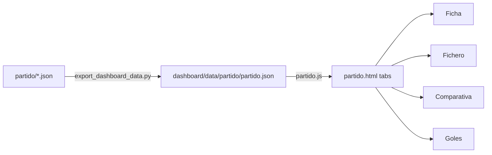

# Lee y ejecuta el encargo blueprints/encargo_bob_pagina_partido_fer.md.

Antes de escribir código:
1. Lee AGENTS.md y bob_sessions/sesion_25_validacion_fer.md.
2. Revisa dashboard/components/partido.js, dashboard/components/fichero.js y scripts/export_dashboard_data.py.
3. Propónme un plan por pasos y, en especial, cómo vas a manejar los colores de los equipos (sección 2, punto 2). Espera mi aprobación.

Reglas: rama feat-costa-rica, sin commit ni push, sin git add -A, no toques chat_agent.py, chat_verificador.py ni importar_datos_fer.py. Tope de ~40 Bob coins. Al terminar, escribe bob_sessions/sesion_26_pagina_partido_fer.md y lista los archivos que tocaste. nota el repo es  https://github.com/FerTC8/omnimorph-costa-rica-skn-2024.git

---

**Status:** active  **Date:** 2026-11-14

---

### 👤 User

Lee y ejecuta el encargo blueprints/encargo_bob_pagina_partido_fer.md.

Antes de escribir código:
1. Lee AGENTS.md y bob_sessions/sesion_25_validacion_fer.md.
2. Revisa dashboard/components/partido.js, dashboard/components/fichero.js y scripts/export_dashboard_data.py.
3. Propónme un plan por pasos y, en especial, cómo vas a manejar los colores de los equipos (sección 2, punto 2). Espera mi aprobación.

Reglas: rama feat-costa-rica, sin commit ni push, sin git add -A, no toques chat_agent.py, chat_verificador.py ni importar_datos_fer.py. Tope de ~40 Bob coins. Al terminar, escribe bob_sessions/sesion_26_pagina_partido_fer.md y lista los archivos que tocaste. nota el repo es  https://github.com/FerTC8/omnimorph-costa-rica-skn-2024.git

---

### 🤖 Assistant

> 🔧 called: use_skill


> 🔧 **use_skill** — create-plan

### 🤖 Assistant

> 🔧 called: read_file, read_file, read_file

Now let me read all the required files in parallel before forming a plan.

> 🔧 **read_file** — c:\Users\Dell G3\Documents\omnimorph-pruebas\AGENTS.md

> 🔧 **read_file** — c:\Users\Dell G3\Documents\omnimorph-pruebas\bob_sessions\sesion_25_validacion_fer.md

> 🔧 **read_file** — c:\Users\Dell G3\Documents\omnimorph-pruebas\blueprints\encargo_bob_pagina_partido_fer.md

### 🤖 Assistant

> 🔧 called: read_file, read_file, read_file

Now let me read the existing dashboard components and scripts:

> 🔧 **read_file** — structure of fichero.js: how player data is rendered, what fields are used from partido.json

> 🔧 **read_file** — how export_dashboard_data.py builds partido.json, what fields are exported, what is NOT yet exported (eventos)

> 🔧 **read_file** — structure of partido.js: tabs, sections, how data is consumed from partido.json, el() stat() seccion patterns, color usage

### 🤖 Assistant

> 🔧 called: read_file, read_file

Now let me read the partido.js key functions in detail, plus check relevant data files:

> 🔧 **read_file** — renderGoles function: how it reads jugada, tipo_jugada, narracion. renderFicha: what it shows. renderComparativa: how metricas are shown. tablaCompleta: structure

> 🔧 **read_file** — partido.config.json: color_ui fields, equipo names, team_id values

### 🤖 Assistant

> 🔧 called: read_file, read_file, list_files

Now let me check the actual data files for Costa Rica and the fer_validacion SVGs:

> 🔧 **list_files** — c:\Users\Dell G3\Documents\omnimorph-pruebas\data\partidos\costa_rica_skn_eliminatorias_2026\fer_validacion\assets

> 🔧 **read_file** — coordenadas_fifa structure, jugada field, zona_remate, pie_remate, segundo_oficial for all 4 goals

> 🔧 **read_file** — rendimiento_individual_destacado structure and metricas_adicionales structure

### 🤖 Assistant

> 🔧 called: read_file, read_file


> 🔧 **read_file** — README.md: coordenadas_fifa meaning, axis direction, pitch dimensions, which end x=0 and x=100

> 🔧 **read_file** — metricas_adicionales structure, keys, per-time breakdown

### 🤖 Assistant

> 🔧 called: read_file, read_file


> 🔧 **read_file** — metricas_adicionales structure and content - all keys and values

> 🔧 **read_file** — coordenadas_fifa axis meaning: which direction, x=0 or x=100 Costa Rica goal, pitch size

### 🤖 Assistant

> 🔧 called: read_file, read_file


> 🔧 **read_file** — eventos_partido.json full content - type, equipo, jugador, minuto fields

> 🔧 **read_file** — metricas_adicionales full structure - all keys, periods, values

### 🤖 Assistant

> 🔧 called: read_file, glob

Now I have enough information to propose a comprehensive plan. Let me check the CSS to understand current color usage and swatch patterns:

> 🔧 **read_file** — swatch CSS classes - swatch--bra, swatch--ger, bar--bra, camiseta--bra colors. How color_ui is applied to elements

> 🔧 **glob** — **/*.css

### 🤖 Assistant

> 🔧 called: read_file


> 🔧 **read_file** — swatch colors bra ger - CSS variables for team colors, bar-- classes, camiseta-- colors

### 🤖 Assistant

> 🔧 called: read_file


> 🔧 **read_file** — swatch--bra swatch--ger bar--bra bar--ger camiseta--bra colors partido CSS definitions

### 🤖 Assistant

> 🔧 called: read_file

Now I have a thorough understanding of the entire codebase. Let me also check how `iniciar()` reads colors to understand the full flow:

> 🔧 **read_file** — iniciar function: how EQUIPOS array is built, how colores/color_ui is used, what CLASES_EQ maps to

### 🤖 Assistant

> 🔧 called: update_todo_list

Now I have a complete, grounded picture of the entire system. I can produce the plan.

> 🔧 **update_todo_list** — 
[-] Gather requirements, read all relevant files, propose plan to user
[ ] User approves plan → write plan file
[ ] Switch to Agent mode and implement


### 🤖 Assistant

> 🔧 called: ask_followup_question

Here is the full plan based on what I've read. Let me walk you through it, including the colour-handling proposal you asked about.

---

## What the codebase does today



Key facts discovered:

- [`iniciar()`](dashboard/components/partido.js:163) in `partido.js` reads `D.colores` from `partido.json` and **dynamically overwrites `--color-team-a`/`--color-team-b`** CSS variables on `document.documentElement.style`. That is the only place those CSS vars get team-specific values at runtime. The same vars drive `.swatch--bra`, `.bar--bra`, `.camiseta--bra`, etc. in [`match-hub.css`](dashboard/styles/components/match-hub.css:143).
- `D.colores` today comes from `color_ui` in `partido.config.json` (SKN `#FF1493`, CRC `#00BFFF`).
- `color_ui` is **also** referenced in `mateo_data.json` (team_a_color / team_b_color) for the MATEO radar/clip page. That page has its own CSS vars (`--color-team-a/b`) set by its own JS, so they are independent. No cross-contamination.
- [`export_partido()`](scripts/export_dashboard_data.py:250) does **not** export `eventos_partido.json`.
- `renderGoles` reads `g.tipo_jugada` (null for all 4 CRC goals) for the Jugada column, and shows `g.narracion` in the detail box. `g.jugada` exists but is never rendered.
- `coordenadas_fifa` are in the range 0–100 (confirmed in `README.md`: "coordenadas IFES `(0..100)`"). The goals are all at x≈79–95, meaning they are near the **attacking end** (Costa Rica attacks toward x=100 in this encoding, confirming x=100 is the opponent's goal).
- `metricas_adicionales` exists in `estadisticas_partido.json` but is never read by the exporter or the JS.
- `eventos_partido.json` exists with 30 events, never exported.
- `fichero.js` renders players from `plantilla` but has no field for `rol_tactico` or `rendimiento_individual_destacado`.
- `renderFicha` has no blocks for `contexto_competitivo`, `datos_no_disponibles`, or `discrepancias_resueltas`.

---

## Section 2, Point 2 — Colour proposal

**The problem:** `color_ui` for SKN is `#FF1493` (hot pink) and CRC is `#00BFFF` (sky blue). These are pipeline classifier colours baked into rendered videos and the MATEO radar. The real uniforms are CRC red (`#c8102e`) and SKN green (`#009739`).

**Proposed approach (matches the blueprint's suggestion):**

1. **Add `color_uniforme` as a new optional field per team in `partido.config.json`** — only for the Partido page. For CRC: `{"principal":"#c8102e","accento":"#102a56"}`, for SKN: `{"principal":"#009739","accento":"#166534"}`.

2. **`export_dashboard_data.py`** exports a new key `colores_uniforme` alongside the existing `colores` key. `colores` stays untouched so Brasil continues to work without change.

3. **`partido.js` `iniciar()`** reads `D.colores_uniforme` **if it exists** and applies it to two new CSS variables — say `--color-partido-a` and `--color-partido-b` — **separate from** `--color-team-a/b`. This means MATEO radar colours remain untouched; only the Partido page uses the new vars.

4. **CSS** (new block in `match-hub.css`): `.swatch--partido-a`, `.swatch--partido-b`, `.bar--partido-a`, `.bar--partido-b`, etc. reference `--color-partido-a/b`. The `iniciar()` function assigns `EQUIPOS` entries the class suffix `partido-a/partido-b` when `colores_uniforme` is present, **otherwise falls back to the existing `bra/ger` names**. This keeps Brasil working.

5. **Accessibility**: red (`#c8102e`) vs green (`#009739`) is a known red-green colour-blindness pair. We distinguish them **also** by text label (team name shown next to every swatch) and by using CRC's accent blue `#102a56` as a secondary pattern where needed. No element relies on colour alone.

6. **Leyenda note in the Comparativa tab**: a one-line caption "Colores: uniforme real del partido (distintos a los colores del análisis de video)" so it's clear why they differ.

---

## Plan — 7 sub-tasks

### Sub-task 1 — Export `eventos` and `colores_uniforme` in `export_dashboard_data.py`
Add `eventos` (from `eventos_partido.json`) and `colores_uniforme` (from `partido.config.json`) to the `partido.json` output. Also copy the 3 Fer SVGs to `dashboard/data/partido/`. No changes to the Brasil export path.

### Sub-task 2 — Colour tokens: add `color_uniforme` to `partido.config.json` + CSS vars
Add the `color_uniforme` block to [`partido.config.json`](data/partidos/costa_rica_skn_eliminatorias_2026/partido.config.json). Add `--color-partido-a/b` CSS vars (default to `--color-team-a/b`) and new `.swatch--partido-a/b`, `.bar--partido-a/b` rules to `match-hub.css`. Modify `iniciar()` to set the vars from `D.colores_uniforme` and assign the new class suffix when present.

### Sub-task 3 — Goles: show `jugada`, `zona_remate`, `pie_remate`, second-official clock, mini-pitch
In `renderGoles` and `marcarGol`, replace the `tipo_jugada` column with `jugada` (falling back to `narracion`). The detail box shows `jugada`, `zona_remate`, `pie_remate`, and the minute+seconds converted from `segundo_oficial`. Draw an inline SVG mini-pitch using `coordenadas_fifa` (x grows toward the attacking end; the shot dots appear near x≈80–95).

### Sub-task 4 — Eventos: new "Eventos" tab with timeline
Add a new tab `eventos` to `TODOS_TABS`/`TABS`. `renderEventos` reads `D.eventos`, shows each event as a timeline row with emoji/icon per type, team colour accent, minute, and description. Hides the tab if `D.eventos` is missing (keeps Brasil safe).

### Sub-task 5 — Fichero: add `rol_tactico` + rendimiento individual
In `fichero.js`, extend `pintarDetalle` to show `j.rol_tactico` (from `plantilla`) and, if the player has an entry in `rendimiento_individual_destacado`, show calificación, toques, pases (completados/intentados), tiros, duelos, recuperaciones (and atajadas/goles_recibidos for keepers). The data must be passed down from `D.estadisticas.rendimiento_individual_destacado`, indexed by dorsal+equipo.

### Sub-task 6 — Comparativa: add `metricas_adicionales` table
In `tablaCompleta` (or a second table below it), render `metricas_adicionales` by time period with the existing `.tbl` structure. Guard with a check that the key exists. Also add the leyenda caption about uniform vs pipeline colours.

### Sub-task 7 — Ficha: add contexto competitivo, datos no disponibles, discrepancias; show Fer SVGs
In `renderFicha`, add:  
- Competitive context paragraph from `partido.contexto_competitivo`  
- A `<details>` block for `datos_no_disponibles`  
- A `<details>` block for `discrepancias_resueltas`  
Add the 3 Fer SVG diagrams at appropriate points in the page (Ficha and Goles tabs) with `` and credit "Diagrama: equipo de análisis (Fer)".

---

## Open questions for you

1. **Colour: the sub-tasks above assume the new `color_uniforme` field + separate CSS vars approach.** Does that match your vision, or would you prefer a simpler approach (e.g., just hardcode the hex values into the CSS without touching `partido.config.json`)?

2. **Mini-pitch in Goles (sub-task 3):** The coordinates are 0–100, x grows toward x=100 which is the attacking goal (CRC scores all 4 goals at x≈80–95). Should I draw the pitch with CRC attacking **left-to-right** (x=0=CRC half, x=100=SKN goal) which is how it looks in the first half? Or always show CRC attacking right-to-left (second half perspective)? Or just show a plain dot on a rectangular pitch with no directional labelling?

3. **New "Eventos" tab vs a strip inside Ficha:** Sub-task 4 proposes a new tab. Would you prefer the event timeline inside the Ficha tab (as a collapsible `<details>` block) to avoid adding a 5th tab?

4. **Fer SVG diagrams:** Sub-task 7 proposes showing them in Ficha (esquemas_tacticos, uniformes_y_zonas) and Goles (uniformes_y_zonas for the zone reference). The `timeline_partido.svg` would go in the Eventos section. Does that placement make sense, or should all 3 be in Ficha?

### 🤖 Assistant

¿Apruebas el plan con estos 7 sub-tasks? Y respóndeme las 4 preguntas abiertas (colores, mini-cancha, Eventos tab vs Ficha, y dónde van los SVG de Fer).

> 🔧 **ask_followup_question** — ¿Apruebas el plan con estos 7 sub-tasks? Y respóndeme las 4 preguntas abiertas (colores, mini-cancha, Eventos tab vs Ficha, y dónde van los SVG de Fer).

---

### 👤 User

apruebo el plan pero debo cambiar el modo no?

---

### 🤖 Assistant

> 🔧 called: write_file

Sí, exactamente. El modo Plan solo permite investigar y proponer — para escribir código necesitas el modo **Agent**.

Antes de cambiar, déjame escribir el archivo del plan para que el agente lo tenga como referencia durante la implementación.

> 🔧 **write_file** — c:\Users\Dell G3\Documents\omnimorph-pruebas\blueprints\plan_pagina_partido_fer.md

### 🤖 Assistant

> 🔧 called: update_todo_list


> 🔧 **update_todo_list** — 
[x] Gather requirements, read all relevant files, propose plan to user
[x] User approves plan → write plan file (blueprints/plan_pagina_partido_fer.md)
[ ] Switch to Agent mode and implement


### 🤖 Assistant

Plan escrito en [`blueprints/plan_pagina_partido_fer.md`](blueprints/plan_pagina_partido_fer.md).

Sí, necesitas cambiar a modo **Agent** para implementar. Puedes hacerlo con el botón de modo en la interfaz de Bob, o yo puedo cambiar ahora mismo. ¿Quieres que haga el switch?

---

### 👤 User

dale

---

### 🤖 Assistant

> 🔧 called: update_todo_list


> 🔧 **update_todo_list** — 
[x] Gather requirements, read all relevant files, propose plan to user
[x] User approves plan → write plan file (blueprints/plan_pagina_partido_fer.md)
[-] ST-1: Exportar eventos y colores_uniforme en export_dashboard_data.py
[ ] ST-2: Tokens de color de uniforme: partido.config.json + CSS + partido.js
[ ] ST-3: Goles: jugada, zona_remate, pie_remate, segundo oficial, mini-cancha
[ ] ST-4: Nueva pestaña Eventos
[ ] ST-5: Fichero: rol_tactico + rendimiento individual
[ ] ST-6: Comparativa: metricas_adicionales
[ ] ST-7: Ficha: contexto competitivo, datos no disponibles, discrepancias + SVGs de Fer
[ ] Verificación final + sesion_26


### 🤖 Assistant

> 🔧 called: read_file, read_file

Let me start with ST-1. First, I need to check `partido_config.py` to understand the `Equipo` class structure:

> 🔧 **read_file** — Equipo class definition: fields, color_ui property, how equipo() method works

> 🔧 **read_file** — contexto_partido.json partido_info structure: what fields are under partido_info (contexto_competitivo, datos_no_disponibles, discrepancias_resueltas)

### 🤖 Assistant

> 🔧 called: read_file


> 🔧 **read_file** — datos_no_disponibles and discrepancias_resueltas fields in partido_info

### 🤖 Assistant

> 🔧 called: read_file

Good. Now I have everything I need. Let me also check how `equipo_por_codigo` is used in the exporter to understand how to safely add `color_uniforme` without breaking the dataclass:

> 🔧 **read_file** — esquema_nota and uniforme_detalle fields in equipos section

### 🤖 Assistant

> 🔧 called: read_file


> 🔧 **read_file** — esquema_nota and uniforme_detalle fields - where they appear in the equipos section

### 🤖 Assistant

> 🔧 called: read_file


> 🔧 **read_file** — esquema_nota uniforme_detalle entrenador_nacionalidad fields in equipos

### 🤖 Assistant

> 🔧 called: apply_diff

Now I have everything. Let me execute all the changes. I'll do ST-1 and ST-2 together since they're closely related (both touch the exporter and config), then proceed through the other sub-tasks.

**ST-1: `partido.config.json` — add `color_uniforme`**

> 🔧 **apply_diff** — c:\Users\Dell G3\Documents\omnimorph-pruebas\data\partidos\costa_rica_skn_eliminatorias_2026\partido.config.json

### 🤖 Assistant

> 🔧 called: apply_diff

**ST-1: `export_dashboard_data.py` — add eventos, colores_uniforme, and Fer SVGs**

> 🔧 **apply_diff** — c:\Users\Dell G3\Documents\omnimorph-pruebas\scripts\export_dashboard_data.py

### 🤖 Assistant

> 🔧 called: apply_diff

Now I need to check where `color_uniforme` comes from. The exporter reads it from `contexto["equipos"][k]` but `color_uniforme` is actually in `partido.config.json` (under `equipos.0/1`), not in `contexto_partido.json`. Let me verify what `contexto["equipos"]` contains vs what `partido.config.json` has:

The exporter reads `contexto_partido.json` → `equipos` for the equipo data. The `color_uniforme` I just added is in `partido.config.json`. The `eq_cfg` path in the exporter reads from `contexto["equipos"][k]` which is `contexto_partido.json`'s equipos. That dict does NOT have `color_uniforme`. The fallback using `getattr(equipo_obj, "color_uniforme", None)` also won't work since the `Equipo` dataclass doesn't have that field.

The simplest fix: read `color_uniforme` directly from the raw config file, which I already modified. Let me update the exporter to read from the config JSON directly:

> 🔧 **apply_diff** — <<<<<<< SEARCH
:start_line:290
-------
    # Colores del uniforme real (opcional: distinto de color_ui del pipeline)
    colores_uniforme: dict = {}
    for k in equipos_orden:
        eq_cfg = contexto["equipos"][k]
        cu = eq_cfg.get("color_uniforme")
        if not cu:
            # También intentar desde partido.config.json a través del Equipo Python
            equipo_obj = PARTIDO.equipo(int(equipos[k]["team_id"]))
            cu = getattr(equipo_obj, "color_uniforme", None)
        if cu and isinstance(cu, dict) and cu.get("principal"):
            colores_uniforme[k] = cu["principal"]
    if colores_uniforme:
        data["colores_uniforme"] = colores_uniforme
=======
    # Colores del uniforme real (opcional: distinto de color_ui del pipeline)
    # Se leen desde partido.config.json porque contexto_partido.json no los contiene.
    colores_uniforme: dict = {}
    cfg_path = PARTIDO_SRC / "partido.config.json"
    if cfg_path.exists():
        cfg_raw = _load_json(cfg_path)
        for tid_str, eq_raw in cfg_raw.get("equipos", {}).items():
            cu = eq_raw.get("color_uniforme")
            if cu and isinstance(cu, dict) and cu.get("principal"):
                # Mapear team_id → clave de equipos_orden
                for k in equipos_orden:
                    if str(equipos[k].get("team_id")) == str(tid_str):
                        colores_uniforme[k] = cu["principal"]
                        break
    if colores_uniforme:
        data["colores_uniforme"] = colores_uniforme
>>>>>>> REPLACE


### 🤖 Assistant

> 🔧 called: execute_command

Now run the exporter to verify ST-1 works:

> 🔧 **execute_command** — $env:PYTHONIOENCODING = "utf-8"; .\.venv\Scripts\python.exe scripts\export_dashboard_data.py --solo-partido

### 🤖 Assistant

> 🔧 called: execute_command

SVGs copied. Let me verify `partido.json` has the new keys:

> 🔧 **execute_command** — $env:PYTHONIOENCODING = "utf-8"; .\.venv\Scripts\python.exe -c "
import json, pathlib
d = json.loads(pathlib.Path('dashboard/data/partido/partido.json').read_text(encoding='utf-8'))
print('eventos count:', len(d.get('eventos', [])))
print('colores_uniforme:', d.get('colores_uniforme'))
print('top keys:', list(d.keys()))
"

### 🤖 Assistant

> 🔧 called: update_todo_list

ST-1 complete. Now **ST-2: CSS tokens + `partido.js` colour logic**.

> 🔧 **update_todo_list** — 
[x] Gather requirements, read all relevant files, propose plan to user
[x] User approves plan → write plan file (blueprints/plan_pagina_partido_fer.md)
[x] ST-1: Exportar eventos y colores_uniforme en export_dashboard_data.py
[-] ST-2: Tokens de color de uniforme: partido.config.json + CSS + partido.js
[ ] ST-3: Goles: jugada, zona_remate, pie_remate, segundo oficial, mini-cancha
[ ] ST-4: Nueva pestaña Eventos
[ ] ST-5: Fichero: rol_tactico + rendimiento individual
[ ] ST-6: Comparativa: metricas_adicionales
[ ] ST-7: Ficha: contexto competitivo, datos no disponibles, discrepancias + SVGs de Fer
[ ] Verificación final + sesion_26


### 🤖 Assistant

> 🔧 called: apply_diff

**ST-2a: `tokens.css` — add `--color-partido-a/b`**

> 🔧 **apply_diff** — <<<<<<< SEARCH
:start_line:21
-------
  /* ── Colores: Equipos y balón ───────────────────────────────────────────── */
  --color-team-a:       #F5A623; /* BRA — naranja */
  --color-team-b:       #F5F3EE; /* GER — crema   */
  --color-ball:         #A3E635; /* balón — lima   */
=======
  /* ── Colores: Equipos y balón ───────────────────────────────────────────── */
  --color-team-a:       #F5A623; /* BRA — naranja */
  --color-team-b:       #F5F3EE; /* GER — crema   */
  --color-ball:         #A3E635; /* balón — lima   */

  /* ── Colores: Uniforme real (página Partido). Fallback = color pipeline.   */
  /* partido.js los sobreescribe con colores_uniforme de partido.json.        */
  --color-partido-a:    var(--color-team-a);
  --color-partido-b:    var(--color-team-b);
>>>>>>> REPLACE


### 🤖 Assistant

> 🔧 called: apply_diff

**ST-2b: `match-hub.css` — add partido-a/b swatch and bar rules**

> 🔧 **apply_diff** — <<<<<<< SEARCH
:start_line:143
-------
.swatch--bra { background-color: var(--color-team-a); }
.swatch--ger { background-color: var(--color-team-b); }
=======
.swatch--bra { background-color: var(--color-team-a); }
.swatch--ger { background-color: var(--color-team-b); }
.swatch--partido-a { background-color: var(--color-partido-a); }
.swatch--partido-b { background-color: var(--color-partido-b); }
>>>>>>> REPLACE

<<<<<<< SEARCH
:start_line:229
-------
.tbl .group--bra { color: var(--color-team-a); }
.tbl .group--ger { color: var(--color-team-b); }
=======
.tbl .group--bra { color: var(--color-team-a); }
.tbl .group--ger { color: var(--color-team-b); }
.tbl .group--partido-a { color: var(--color-partido-a); }
.tbl .group--partido-b { color: var(--color-partido-b); }
>>>>>>> REPLACE

<<<<<<< SEARCH
:start_line:304
-------
.chart .bar--bra { fill: var(--color-team-a); }
.chart .bar--ger { fill: var(--color-team-b); }
=======
.chart .bar--bra { fill: var(--color-team-a); }
.chart .bar--ger { fill: var(--color-team-b); }
.chart .bar--partido-a { fill: var(--color-partido-a); }
.chart .bar--partido-b { fill: var(--color-partido-b); }
>>>>>>> REPLACE


### 🤖 Assistant

> 🔧 called: read_file

**ST-2c: `fichero.css` — add camiseta partido-a/b**

> 🔧 **read_file** — camiseta--bra camiseta--ger lines

### 🤖 Assistant

> 🔧 called: apply_diff


> 🔧 **apply_diff** — <<<<<<< SEARCH
:start_line:71
-------
.camiseta--bra path { fill: var(--color-team-a); }
.camiseta--ger path { fill: var(--color-team-b); }
=======
.camiseta--bra path { fill: var(--color-team-a); }
.camiseta--ger path { fill: var(--color-team-b); }
.camiseta--partido-a path { fill: var(--color-partido-a); }
.camiseta--partido-b path { fill: var(--color-partido-b); }
>>>>>>> REPLACE

<<<<<<< SEARCH
:start_line:93
-------
.fichero__detalle {
  position: sticky;
  top: 72px;
  display: flex;
  flex-direction: column;
  gap: var(--space-3);
  min-height: 460px;
  padding: var(--cell-padding-y) var(--cell-padding-x);
  border-right: var(--border);
  border-top: 3px solid var(--color-team-a);
}

.fichero__detalle--ger {
  border-top-color: var(--color-team-b);
}
=======
.fichero__detalle {
  position: sticky;
  top: 72px;
  display: flex;
  flex-direction: column;
  gap: var(--space-3);
  min-height: 460px;
  padding: var(--cell-padding-y) var(--cell-padding-x);
  border-right: var(--border);
  border-top: 3px solid var(--color-team-a);
}

.fichero__detalle--ger {
  border-top-color: var(--color-team-b);
}
.fichero__detalle--partido-a {
  border-top-color: var(--color-partido-a);
}
.fichero__detalle--partido-b {
  border-top-color: var(--color-partido-b);
}
>>>>>>> REPLACE

<<<<<<< SEARCH
:start_line:203
-------
.carta[aria-pressed="true"] {
  border-color: var(--color-team-a);
  box-shadow: inset 0 0 0 1px var(--color-team-a);
}

.carta--ger[aria-pressed="true"] {
  border-color: var(--color-team-b);
  box-shadow: inset 0 0 0 1px var(--color-team-b);
}
=======
.carta[aria-pressed="true"] {
  border-color: var(--color-team-a);
  box-shadow: inset 0 0 0 1px var(--color-team-a);
}

.carta--ger[aria-pressed="true"] {
  border-color: var(--color-team-b);
  box-shadow: inset 0 0 0 1px var(--color-team-b);
}

.carta--partido-a[aria-pressed="true"] {
  border-color: var(--color-partido-a);
  box-shadow: inset 0 0 0 1px var(--color-partido-a);
}

.carta--partido-b[aria-pressed="true"] {
  border-color: var(--color-partido-b);
  box-shadow: inset 0 0 0 1px var(--color-partido-b);
}
>>>>>>> REPLACE


### 🤖 Assistant

> 🔧 called: apply_diff

**ST-2d: `partido.js` — use `colores_uniforme` to set CSS vars and choose class suffix**

> 🔧 **apply_diff** — <<<<<<< SEARCH
:start_line:13
-------
  var CLASES_EQ = ['bra', 'ger'];
  var EQUIPOS = [];
=======
  var CLASES_EQ_DEFAULT = ['bra', 'ger'];
  var CLASES_EQ_UNIFORME = ['partido-a', 'partido-b'];
  var EQUIPOS = [];
>>>>>>> REPLACE

<<<<<<< SEARCH
:start_line:159
-------
    EQUIPOS = orden.map(function (k, i) {
      return [k, D.equipos[k].pais, CLASES_EQ[i] || 'bra', D.equipos[k].codigo];
    });

    if (D.colores && orden.length >= 2) {
      var root = document.documentElement.style;
      if (D.colores[orden[0]]) root.setProperty('--color-team-a', D.colores[orden[0]]);
      if (D.colores[orden[1]]) root.setProperty('--color-team-b', D.colores[orden[1]]);
    }
=======
    var tieneUniforme = D.colores_uniforme && orden.length >= 2 &&
      (D.colores_uniforme[orden[0]] || D.colores_uniforme[orden[1]]);
    var clasesEq = tieneUniforme ? CLASES_EQ_UNIFORME : CLASES_EQ_DEFAULT;
    EQUIPOS = orden.map(function (k, i) {
      return [k, D.equipos[k].pais, clasesEq[i] || 'bra', D.equipos[k].codigo];
    });

    if (D.colores && orden.length >= 2) {
      var root = document.documentElement.style;
      if (D.colores[orden[0]]) root.setProperty('--color-team-a', D.colores[orden[0]]);
      if (D.colores[orden[1]]) root.setProperty('--color-team-b', D.colores[orden[1]]);
    }
    if (tieneUniforme) {
      var root2 = document.documentElement.style;
      if (D.colores_uniforme[orden[0]]) root2.setProperty('--color-partido-a', D.colores_uniforme[orden[0]]);
      if (D.colores_uniforme[orden[1]]) root2.setProperty('--color-partido-b', D.colores_uniforme[orden[1]]);
    }
>>>>>>> REPLACE


### 🤖 Assistant

> 🔧 called: apply_diff

**ST-2e: `fichero.js` — accept `clasesEq` parameter and use uniform classes**

The `renderFichero` function in `partido.js` calls `window.OmniFichero.render($('panel-fichero'), D, el)`. I need to pass the class array through. The cleanest approach: `fichero.js` reads `D.colores_uniforme` directly, same logic.

> 🔧 **apply_diff** — <<<<<<< SEARCH
:start_line:10
-------
  var CLASES_EQ = ['bra', 'ger'];
=======
  var CLASES_EQ_DEFAULT = ['bra', 'ger'];
  var CLASES_EQ_UNIFORME = ['partido-a', 'partido-b'];
>>>>>>> REPLACE

<<<<<<< SEARCH
:start_line:76
-------
  function render(host, datos, el) {
    var orden = (datos.equipos_orden && datos.equipos_orden.length)
      ? datos.equipos_orden
      : Object.keys(datos.equipos);
    var equipos = orden.map(function (k, i) {
      return [k, datos.equipos[k].codigo, CLASES_EQ[i] || 'bra'];
    });
=======
  function render(host, datos, el) {
    var orden = (datos.equipos_orden && datos.equipos_orden.length)
      ? datos.equipos_orden
      : Object.keys(datos.equipos);
    var tieneUniforme = datos.colores_uniforme && orden.length >= 2 &&
      (datos.colores_uniforme[orden[0]] || datos.colores_uniforme[orden[1]]);
    var clasesEq = tieneUniforme ? CLASES_EQ_UNIFORME : CLASES_EQ_DEFAULT;
    var equipos = orden.map(function (k, i) {
      return [k, datos.equipos[k].codigo, clasesEq[i] || 'bra'];
    });
>>>>>>> REPLACE


### 🤖 Assistant

> 🔧 called: apply_diff

ST-2 complete. Now **ST-3: Goles improvements**. I need to update `renderGoles` and `marcarGol`:

> 🔧 **apply_diff** — <<<<<<< SEARCH
:start_line:487
-------
  // ── Goles ────────────────────────────────────────────────────────────────
  function renderGoles() {
    var host = $('panel-goles');
    vaciar(host);
    var hayCoordenadas = D.goles.some(function (g) { return g.coordenadas_campo_cm != null; });
    if (hayCoordenadas) {
      host.appendChild(el('div', { class: 'figure' }, el('img', { src: '../data/partido/mapa_8_goles.svg',
        alt: 'Mapa de la cancha con la posición de remate de los ' + D.goles.length + ' goles' })));
      host.appendChild(el('p', { class: 'caption',
        text: 'El tamaño de cada punto indica el xG estimado. Las coordenadas están normalizadas: ' + EQUIPOS[1][1] + ' siempre ataca hacia la izquierda, también en el 2T.' }));
    }

    var tbody = el('tbody');
    D.goles.forEach(function (g, i) {
      var fila = el('tr', { 'data-row': String(i), tabindex: 0, 'aria-selected': i === golActivo ? 'true' : 'false' },
        el('td', { class: 'num', text: g.minuto + "'" }),
        el('td', { class: 'num', text: g.marcador_momento }),
        el('td', { text: g.anotador ? g.anotador.nombre : '—' }),
        el('td', { class: 'soft', text: g.asistente && g.asistente.nombre ? g.asistente.nombre : '—' }),
        el('td', { class: 'soft', text: g.tipo_jugada || '—' }),
        el('td', { class: 'num', text: num(g.xg, 2) }),
        el('td', { class: 'num', text: num(g.distancia_porteria_m, 1) }));
      var elegir = function () { golActivo = i; marcarGol(); };
      fila.addEventListener('click', elegir);
      fila.addEventListener('keydown', function (e) { if (e.key === 'Enter' || e.key === ' ') { e.preventDefault(); elegir(); } });
      tbody.appendChild(fila);
    });
    host.appendChild(el('div', { class: 'table-wrap' }, el('table', { class: 'tbl', id: 'tabla-goles' },
      el('thead', null, el('tr', null, el('th', { text: 'Min' }), el('th', { class: 'num', text: 'Marcador' }),
        el('th', { text: 'Anotador' }), el('th', { text: 'Asistente' }), el('th', { text: 'Jugada' }),
        el('th', { class: 'num', text: 'xG est.' }), el('th', { class: 'num', text: 'Dist. (m)' }))),
      tbody)));
    host.appendChild(el('div', { class: 'detail', id: 'detalle-gol', 'aria-live': 'polite' }));
    marcarGol();
  }

  function marcarGol() {
    document.querySelectorAll('#tabla-goles tr[data-row]').forEach(function (r) {
      r.setAttribute('aria-selected', Number(r.getAttribute('data-row')) === golActivo ? 'true' : 'false');
    });
    var g = D.goles[golActivo], box = $('detalle-gol');
    vaciar(box);
    box.appendChild(el('p', null, el('strong', { text: g.minuto + "' · " + g.anotador.nombre + ' (' + g.marcador_momento + ')' })));
    if (g.nota_tactica) box.appendChild(el('p', null, el('strong', { text: 'Análisis táctico. ' }), g.nota_tactica));
    if (g.narracion) box.appendChild(el('p', null, el('strong', { text: 'Relato. ' }), g.narracion));
  }
=======
  // ── Goles ────────────────────────────────────────────────────────────────

  /** Convierte segundos desde el inicio del partido a mm:ss. */
  function segAMinutos(s) {
    if (s == null) return null;
    var m = Math.floor(s / 60), sec = s % 60;
    return m + "'" + (sec > 0 ? String(sec).padStart(2, '0') + '"' : '');
  }

  /** Mini-cancha SVG con un punto en coordenadas FIFA (0–100). */
  function miniCancha(coordenadas) {
    if (!coordenadas || coordenadas.x == null || coordenadas.y == null) return null;
    var W = 210, H = 136, PAD = 8;
    var px = PAD + (coordenadas.x / 100) * (W - 2 * PAD);
    var py = PAD + (coordenadas.y / 100) * (H - 2 * PAD);
    var ns = 'http://www.w3.org/2000/svg';
    var s = document.createElementNS(ns, 'svg');
    s.setAttribute('viewBox', '0 0 ' + W + ' ' + H);
    s.setAttribute('class', 'mini-cancha');
    s.setAttribute('aria-hidden', 'true');
    // fondo
    var bg = document.createElementNS(ns, 'rect');
    bg.setAttribute('x', '0'); bg.setAttribute('y', '0');
    bg.setAttribute('width', String(W)); bg.setAttribute('height', String(H));
    bg.setAttribute('class', 'mini-cancha__bg');
    s.appendChild(bg);
    // borde
    var borde = document.createElementNS(ns, 'rect');
    borde.setAttribute('x', String(PAD)); borde.setAttribute('y', String(PAD));
    borde.setAttribute('width', String(W - 2 * PAD)); borde.setAttribute('height', String(H - 2 * PAD));
    borde.setAttribute('class', 'mini-cancha__linea');
    s.appendChild(borde);
    // línea central
    var lc = document.createElementNS(ns, 'line');
    lc.setAttribute('x1', String(W / 2)); lc.setAttribute('y1', String(PAD));
    lc.setAttribute('x2', String(W / 2)); lc.setAttribute('y2', String(H - PAD));
    lc.setAttribute('class', 'mini-cancha__linea');
    s.appendChild(lc);
    // punto del gol
    var pt = document.createElementNS(ns, 'circle');
    pt.setAttribute('cx', String(Math.round(px))); pt.setAttribute('cy', String(Math.round(py)));
    pt.setAttribute('r', '5');
    pt.setAttribute('class', 'mini-cancha__punto');
    s.appendChild(pt);
    return s;
  }

  function renderGoles() {
    var host = $('panel-goles');
    vaciar(host);
    var hayCoordenadas = D.goles.some(function (g) { return g.coordenadas_campo_cm != null; });
    if (hayCoordenadas) {
      host.appendChild(el('div', { class: 'figure' }, el('img', { src: '../data/partido/mapa_8_goles.svg',
        alt: 'Mapa de la cancha con la posición de remate de los ' + D.goles.length + ' goles' })));
      host.appendChild(el('p', { class: 'caption',
        text: 'El tamaño de cada punto indica el xG estimado. Las coordenadas están normalizadas: ' + EQUIPOS[1][1] + ' siempre ataca hacia la izquierda, también en el 2T.' }));
    }

    // Columnas opcionales: solo si al menos un gol tiene dato
    var hayXg = D.goles.some(function (g) { return g.xg != null; });
    var hayDist = D.goles.some(function (g) { return g.distancia_porteria_m != null; });

    var tbody = el('tbody');
    D.goles.forEach(function (g, i) {
      var jugadaCorta = g.jugada ? (g.jugada.length > 60 ? g.jugada.slice(0, 58) + '…' : g.jugada)
                       : (g.tipo_jugada || '—');
      var cols = [
        el('td', { class: 'num', text: g.minuto + "'" }),
        el('td', { class: 'num', text: g.marcador_momento }),
        el('td', { text: g.anotador ? g.anotador.nombre : '—' }),
        el('td', { class: 'soft', text: g.asistente && g.asistente.nombre ? g.asistente.nombre : '—' }),
        el('td', { class: 'soft goles__jugada', text: jugadaCorta })
      ];
      if (hayXg) cols.push(el('td', { class: 'num', text: num(g.xg, 2) }));
      if (hayDist) cols.push(el('td', { class: 'num', text: num(g.distancia_porteria_m, 1) }));
      var fila = el.apply(null, ['tr', { 'data-row': String(i), tabindex: 0, 'aria-selected': i === golActivo ? 'true' : 'false' }].concat(cols));
      var elegir = function () { golActivo = i; marcarGol(); };
      fila.addEventListener('click', elegir);
      fila.addEventListener('keydown', function (e) { if (e.key === 'Enter' || e.key === ' ') { e.preventDefault(); elegir(); } });
      tbody.appendChild(fila);
    });
    var thCols = [
      el('th', { text: 'Min' }), el('th', { class: 'num', text: 'Marcador' }),
      el('th', { text: 'Anotador' }), el('th', { text: 'Asistente' }), el('th', { text: 'Jugada' })
    ];
    if (hayXg) thCols.push(el('th', { class: 'num', text: 'xG est.' }));
    if (hayDist) thCols.push(el('th', { class: 'num', text: 'Dist. (m)' }));
    host.appendChild(el('div', { class: 'table-wrap' }, el('table', { class: 'tbl', id: 'tabla-goles' },
      el.apply(null, ['thead', null, el.apply(null, ['tr', null].concat(thCols))]),
      tbody)));
    host.appendChild(el('div', { class: 'detail', id: 'detalle-gol', 'aria-live': 'polite' }));
    marcarGol();
  }

  function marcarGol() {
    document.querySelectorAll('#tabla-goles tr[data-row]').forEach(function (r) {
      r.setAttribute('aria-selected', Number(r.getAttribute('data-row')) === golActivo ? 'true' : 'false');
    });
    var g = D.goles[golActivo], box = $('detalle-gol');
    vaciar(box);
    // Encabezado del gol
    var tiempoOficial = segAMinutos(g.segundo_oficial);
    var encab = g.minuto + "'" + (tiempoOficial ? ' (' + tiempoOficial + ' reloj)' : '') +
      ' · ' + (g.anotador ? g.anotador.nombre : '—') + ' (' + g.marcador_momento + ')';
    box.appendChild(el('p', null, el('strong', { text: encab })));
    // Zona y pie de remate
    if (g.zona_remate || g.pie_remate) {
      var detRemate = [g.pie_remate, g.zona_remate].filter(Boolean).join(' · ');
      box.appendChild(el('p', null, el('strong', { text: 'Remate. ' }), detRemate));
    }
    // Mini-cancha con coordenadas FIFA
    var cancha = miniCancha(g.coordenadas_fifa);
    if (cancha) box.appendChild(cancha);
    // Jugada completa (relato de Fer)
    if (g.jugada) box.appendChild(el('p', null, el('strong', { text: 'Jugada. ' }), g.jugada));
    else if (g.narracion) box.appendChild(el('p', null, el('strong', { text: 'Relato. ' }), g.narracion));
    // Análisis táctico (si existe)
    if (g.nota_tactica) box.appendChild(el('p', null, el('strong', { text: 'Análisis táctico. ' }), g.nota_tactica));
  }
>>>>>>> REPLACE


### 🤖 Assistant

> 🔧 called: apply_diff

Now add mini-cancha CSS to `match-hub.css`:

> 🔧 **apply_diff** — <<<<<<< SEARCH
:start_line:333
-------
/* ── Goles y gol de Müller ──────────────────────────────────────────────── */
.figure {
=======
/* ── Mini-cancha (detalle del gol) ─────────────────────────────────────── */
.mini-cancha {
  display: block;
  width: 210px;
  max-width: 100%;
  height: auto;
  margin: var(--space-2) 0;
}

.mini-cancha__bg {
  fill: var(--color-pitch);
}

.mini-cancha__linea {
  fill: none;
  stroke: var(--color-pitch-lines);
  stroke-width: 1.5;
}

.mini-cancha__punto {
  fill: var(--color-ok);
}

/* ── Goles y gol de Müller ──────────────────────────────────────────────── */
.figure {
>>>>>>> REPLACE


### 🤖 Assistant

> 🔧 called: read_file

Now **ST-4: Nueva pestaña Eventos**. First let me check the `partido.html` to understand the tab structure:

> 🔧 **read_file** — tab buttons and panels structure - all tab-* and panel-* IDs, TODOS_TABS references

### 🤖 Assistant

> 🔧 called: apply_diff

**ST-4a: `partido.html` — add `eventos` tab and panel**

> 🔧 **apply_diff** — <<<<<<< SEARCH
:start_line:69
-------
    <div class="tabs" id="tabs" role="tablist" aria-label="Secciones del partido">
      <button class="tab" id="tab-ficha" role="tab" aria-controls="panel-ficha" aria-selected="true" type="button">Ficha previa</button>
      <button class="tab" id="tab-fichero" role="tab" aria-controls="panel-fichero" aria-selected="false" tabindex="-1" type="button">Fichero</button>
      <button class="tab" id="tab-comparativa" role="tab" aria-controls="panel-comparativa" aria-selected="false" tabindex="-1" type="button">Comparativa 1T / 2T</button>
      <button class="tab" id="tab-goles" role="tab" aria-controls="panel-goles" aria-selected="false" tabindex="-1" type="button">Goles</button>
      <button class="tab" id="tab-muller" role="tab" aria-controls="panel-muller" aria-selected="false" tabindex="-1" type="button" hidden></button>
    </div>

    <section class="panel-body" id="panel-ficha" role="tabpanel" aria-labelledby="tab-ficha"></section>
    <section class="panel-body" id="panel-fichero" role="tabpanel" aria-labelledby="tab-fichero" hidden></section>
    <section class="panel-body" id="panel-comparativa" role="tabpanel" aria-labelledby="tab-comparativa" hidden></section>
    <section class="panel-body" id="panel-goles" role="tabpanel" aria-labelledby="tab-goles" hidden></section>
    <section class="panel-body" id="panel-muller" role="tabpanel" aria-labelledby="tab-muller" hidden></section>
=======
    <div class="tabs" id="tabs" role="tablist" aria-label="Secciones del partido">
      <button class="tab" id="tab-ficha" role="tab" aria-controls="panel-ficha" aria-selected="true" type="button">Ficha previa</button>
      <button class="tab" id="tab-fichero" role="tab" aria-controls="panel-fichero" aria-selected="false" tabindex="-1" type="button">Fichero</button>
      <button class="tab" id="tab-comparativa" role="tab" aria-controls="panel-comparativa" aria-selected="false" tabindex="-1" type="button">Comparativa 1T / 2T</button>
      <button class="tab" id="tab-goles" role="tab" aria-controls="panel-goles" aria-selected="false" tabindex="-1" type="button">Goles</button>
      <button class="tab" id="tab-eventos" role="tab" aria-controls="panel-eventos" aria-selected="false" tabindex="-1" type="button" hidden>Eventos</button>
      <button class="tab" id="tab-muller" role="tab" aria-controls="panel-muller" aria-selected="false" tabindex="-1" type="button" hidden></button>
    </div>

    <section class="panel-body" id="panel-ficha" role="tabpanel" aria-labelledby="tab-ficha"></section>
    <section class="panel-body" id="panel-fichero" role="tabpanel" aria-labelledby="tab-fichero" hidden></section>
    <section class="panel-body" id="panel-comparativa" role="tabpanel" aria-labelledby="tab-comparativa" hidden></section>
    <section class="panel-body" id="panel-goles" role="tabpanel" aria-labelledby="tab-goles" hidden></section>
    <section class="panel-body" id="panel-eventos" role="tabpanel" aria-labelledby="tab-eventos" hidden></section>
    <section class="panel-body" id="panel-muller" role="tabpanel" aria-labelledby="tab-muller" hidden></section>
>>>>>>> REPLACE


### 🤖 Assistant

> 🔧 called: apply_diff

**ST-4b: `partido.js` — add `eventos` to TODOS_TABS and renderEventos function**

> 🔧 **apply_diff** — <<<<<<< SEARCH
:start_line:10
-------
  var TODOS_TABS = ['ficha', 'fichero', 'comparativa', 'goles', 'muller'];
=======
  var TODOS_TABS = ['ficha', 'fichero', 'comparativa', 'goles', 'eventos', 'muller'];
>>>>>>> REPLACE


### 🤖 Assistant

> 🔧 called: read_file

Now I need to add the `eventos` tab visibility logic to `iniciar()` and add `renderEventos` to `RENDER`. Let me find the exact lines:

> 🔧 **read_file** — iniciar function: goles tab logic, muller tab logic, RENDER dict line

### 🤖 Assistant

> 🔧 called: apply_diff


> 🔧 **apply_diff** — <<<<<<< SEARCH
:start_line:199
-------
    if (D.gol_muller) {
      TABS.push('muller');
      var apellido = D.gol_muller.metadatos_jugada.anotador.nombre.split(' ').pop();
      $('tab-muller').textContent = 'Gol de ' + apellido;
    }
=======
    if (D.eventos && D.eventos.length) {
      TABS.push('eventos');
      $('tab-eventos').textContent = 'Eventos (' + D.eventos.length + ')';
    }
    if (D.gol_muller) {
      TABS.push('muller');
      var apellido = D.gol_muller.metadatos_jugada.anotador.nombre.split(' ').pop();
      $('tab-muller').textContent = 'Gol de ' + apellido;
    }
>>>>>>> REPLACE

<<<<<<< SEARCH
:start_line:243
-------
  var RENDER = { ficha: renderFicha, fichero: renderFichero, comparativa: renderComparativa, goles: renderGoles, muller: renderMuller };
=======
  var RENDER = { ficha: renderFicha, fichero: renderFichero, comparativa: renderComparativa, goles: renderGoles, eventos: renderEventos, muller: renderMuller };
>>>>>>> REPLACE


### 🤖 Assistant

> 🔧 called: read_file

Now add the `renderEventos` function. I'll insert it before `renderMuller`:

> 🔧 **read_file** — line number of renderMuller function definition

### 🤖 Assistant

> 🔧 called: apply_diff


> 🔧 **apply_diff** — <<<<<<< SEARCH
:start_line:643
-------
  }
})();
=======
  }

  // ── Eventos ──────────────────────────────────────────────────────────────
  var ICONOS_EVENTO = {
    'inicio': '⏱', 'descanso': '⏱', 'final': '⏱',
    'gol': '⚽', 'tarjeta_amarilla': '🟨', 'tarjeta_roja': '🟥',
    'cambio': '🔄', 'poste': '⬛', 'atajada': '🧤',
    'ocasion_clara': '💥', 'atencion_medica': '➕', 'remate_bloqueado': '⛔'
  };

  function claseEquipoEvento(nombreEquipo) {
    if (!nombreEquipo || !EQUIPOS.length) return '';
    var nombre = nombreEquipo.toLowerCase();
    for (var i = 0; i < EQUIPOS.length; i++) {
      if (EQUIPOS[i][1].toLowerCase().indexOf(nombre) >= 0 || nombre.indexOf(EQUIPOS[i][1].toLowerCase()) >= 0) {
        return EQUIPOS[i][2]; // clase CSS del equipo
      }
    }
    return '';
  }

  function renderEventos() {
    var host = $('panel-eventos');
    vaciar(host);

    // Diagrama de Fer: timeline_partido.svg
    var imgTimeline = el('img', {
      src: '../data/partido/timeline_partido.svg',
      alt: 'Línea de tiempo del partido (diagrama del equipo de análisis)',
      class: 'figure__img'
    });
    imgTimeline.onerror = function () { imgTimeline.parentNode && imgTimeline.parentNode.remove(); };
    var figTimeline = el('div', { class: 'figure' }, imgTimeline);
    host.appendChild(figTimeline);
    host.appendChild(el('p', { class: 'caption', text: 'Diagrama: equipo de análisis (Fer)' }));

    host.appendChild(el('div', { class: 'section-label', text: 'Cronología — ' + D.eventos.length + ' eventos' }));

    var lista = el('div', { class: 'eventos-lista' });
    D.eventos.forEach(function (ev) {
      var icono = ICONOS_EVENTO[ev.tipo] || '•';
      var claseEq = claseEquipoEvento(ev.equipo);
      var jugadorTexto = ev.jugador || '';
      if (ev.jugador_secundario) jugadorTexto += ' → ' + ev.jugador_secundario;

      var fila = el('div', { class: 'evento-fila' },
        el('span', { class: 'evento-fila__min', text: ev.minuto }),
        el('span', { class: 'evento-fila__icono', 'aria-hidden': 'true', text: icono }),
        el('span', { class: 'evento-fila__tipo', text: ev.tipo.replace(/_/g, ' ') }),
        claseEq ? el('span', { class: 'swatch swatch--' + claseEq, 'aria-hidden': 'true' }) : null,
        jugadorTexto ? el('span', { class: 'evento-fila__jugador', text: jugadorTexto }) : null,
        el('span', { class: 'evento-fila__desc', text: ev.descripcion || '' })
      );
      lista.appendChild(fila);
    });
    host.appendChild(lista);
  }
})();
>>>>>>> REPLACE


### 🤖 Assistant

> 🔧 called: read_file

Add CSS for the eventos layout in `match-hub.css`:

> 🔧 **read_file** — last few lines of match-hub.css for append point

### 🤖 Assistant

> 🔧 called: insert_content


> 🔧 **insert_content** — c:\Users\Dell G3\Documents\omnimorph-pruebas\dashboard\styles\components\match-hub.css

### 🤖 Assistant

> 🔧 called: apply_diff

Now **ST-5: Fichero — `rol_tactico` + rendimiento individual**. I need to extend `fichero.js`:

> 🔧 **apply_diff** — <<<<<<< SEARCH
:start_line:40
-------
  /** Plantilla del equipo con los goles y asistencias que salen de la cronología. */
  function jugadoresDe(datos, clave) {
    var eq = datos.equipos[clave];
    var propios = (datos.goles || []).filter(function (g) { return g.equipo_anotador === eq.pais; });
    var vistos = (datos.vistos_en_clip && datos.vistos_en_clip[clave]) || [];
    return Object.keys(eq.plantilla).map(function (d) {
      var j = eq.plantilla[d];
      var dorsal = Number(d);
      return {
        dorsal: dorsal,
        nombre: j.nombre,
        posicion: j.posicion,
        titular: j.titular,
        minutos: j.minutos,
        eventos: j.eventos || [],
        visto_en_clip: vistos.indexOf(dorsal) >= 0,
        linea: linea(j.posicion),
        goles: propios.filter(function (g) { return g.anotador && g.anotador.dorsal === dorsal; }).length,
        asistencias: propios.filter(function (g) { return g.asistente && g.asistente.dorsal === dorsal; }).length,
      };
    }).sort(function (a, b) {
      return (b.titular - a.titular) || (ORDEN[a.linea] - ORDEN[b.linea]) || (a.dorsal - b.dorsal);
    });
  }
=======
  /** Índice de rendimiento individual: {equipo+dorsal → stats}. */
  function indiceRendimiento(datos) {
    var lista = datos.estadisticas && datos.estadisticas.rendimiento_individual_destacado;
    if (!lista) return {};
    var idx = {};
    lista.forEach(function (r) {
      var clave = (r.equipo || '') + '|' + r.dorsal;
      idx[clave] = r;
    });
    return idx;
  }

  /** Plantilla del equipo con los goles y asistencias que salen de la cronología. */
  function jugadoresDe(datos, clave, rendIdx) {
    var eq = datos.equipos[clave];
    var propios = (datos.goles || []).filter(function (g) { return g.equipo_anotador === eq.pais; });
    var vistos = (datos.vistos_en_clip && datos.vistos_en_clip[clave]) || [];
    return Object.keys(eq.plantilla).map(function (d) {
      var j = eq.plantilla[d];
      var dorsal = Number(d);
      var rendKey = eq.pais + '|' + dorsal;
      return {
        dorsal: dorsal,
        nombre: j.nombre,
        posicion: j.posicion,
        rol_tactico: j.rol_tactico || null,
        titular: j.titular,
        minutos: j.minutos,
        eventos: j.eventos || [],
        visto_en_clip: vistos.indexOf(dorsal) >= 0,
        linea: linea(j.posicion),
        goles: propios.filter(function (g) { return g.anotador && g.anotador.dorsal === dorsal; }).length,
        asistencias: propios.filter(function (g) { return g.asistente && g.asistente.dorsal === dorsal; }).length,
        rendimiento: rendIdx[rendKey] || null,
      };
    }).sort(function (a, b) {
      return (b.titular - a.titular) || (ORDEN[a.linea] - ORDEN[b.linea]) || (a.dorsal - b.dorsal);
    });
  }
>>>>>>> REPLACE


### 🤖 Assistant

> 🔧 called: read_file

Now update the `render` function to use `indiceRendimiento`, pass it to `jugadoresDe`, show `esquema_nota` in team head, and show `rol_tactico` + rendimiento in `pintarDetalle`:

> 🔧 **read_file** — render function full body from plantillas line to end

### 🤖 Assistant

> 🔧 called: apply_diff


> 🔧 **apply_diff** — <<<<<<< SEARCH
:start_line:102
-------
    var estado = { equipo: equipos[0][0], linea: '', dorsal: null };
    var plantillas = {};
    equipos.forEach(function (e) { plantillas[e[0]] = jugadoresDe(datos, e[0]); });
=======
    var estado = { equipo: equipos[0][0], linea: '', dorsal: null };
    var rendIdx = indiceRendimiento(datos);
    var plantillas = {};
    equipos.forEach(function (e) { plantillas[e[0]] = jugadoresDe(datos, e[0], rendIdx); });
>>>>>>> REPLACE

<<<<<<< SEARCH
:start_line:111
-------
    function pintarDetalle(j) {
      while (detalle.firstChild) detalle.removeChild(detalle.firstChild);
      var codigo = equipos.filter(function (e) { return e[0] === estado.equipo; })[0];
      detalle.className = 'fichero__detalle fichero__detalle--' + codigo[2];
      detalle.appendChild(el('div', { class: 'fichero__retrato' }, camiseta(j.dorsal, codigo[2])));
      detalle.appendChild(el('h2', { text: j.nombre }));
      detalle.appendChild(el('p', { class: 'fichero__puesto',
        text: j.posicion + ' · ' + (j.titular ? 'Titular' : 'Suplente') + ' · ' + codigo[1] }));
      var marcas = insignias(j);
      if (marcas.length) {
        detalle.appendChild(el('div', { class: 'fichero__insignias' }, marcas.map(function (m) {
          return el('span', { class: 'insignia' + (m[1] ? ' insignia--' + m[1] : ''), text: m[0] });
        })));
      }
      detalle.appendChild(el('dl', { class: 'fichero__cifras' },
        [['Minutos', j.minutos], ['Goles', j.goles], ['Asistencias', j.asistencias]].map(function (c) {
          return el('div', null, el('dt', { text: c[0] }), el('dd', { text: String(c[1]) }));
        })));
      if (j.eventos.length) {
        detalle.appendChild(el('ul', { class: 'fichero__eventos' },
          j.eventos.map(function (t) { return el('li', { text: t }); })));
      } else {
        detalle.appendChild(el('p', { class: 'fichero__sin-eventos', text: 'Sin eventos registrados en el partido.' }));
      }
    }
=======
    function numR(v, dec) {
      if (v == null || isNaN(Number(v))) return '—';
      return Number(v).toLocaleString('es-MX', { minimumFractionDigits: dec || 0, maximumFractionDigits: dec || 0 });
    }

    function pintarDetalle(j) {
      while (detalle.firstChild) detalle.removeChild(detalle.firstChild);
      var codigo = equipos.filter(function (e) { return e[0] === estado.equipo; })[0];
      detalle.className = 'fichero__detalle fichero__detalle--' + codigo[2];
      detalle.appendChild(el('div', { class: 'fichero__retrato' }, camiseta(j.dorsal, codigo[2])));
      detalle.appendChild(el('h2', { text: j.nombre }));
      var puestoTexto = j.posicion + ' · ' + (j.titular ? 'Titular' : 'Suplente') + ' · ' + codigo[1];
      if (j.rol_tactico) puestoTexto += ' · ' + j.rol_tactico;
      detalle.appendChild(el('p', { class: 'fichero__puesto', text: puestoTexto }));
      var marcas = insignias(j);
      if (marcas.length) {
        detalle.appendChild(el('div', { class: 'fichero__insignias' }, marcas.map(function (m) {
          return el('span', { class: 'insignia' + (m[1] ? ' insignia--' + m[1] : ''), text: m[0] });
        })));
      }
      detalle.appendChild(el('dl', { class: 'fichero__cifras' },
        [['Minutos', j.minutos], ['Goles', j.goles], ['Asistencias', j.asistencias]].map(function (c) {
          return el('div', null, el('dt', { text: c[0] }), el('dd', { text: String(c[1]) }));
        })));
      // Rendimiento individual FotMob/Opta (si existe)
      var r = j.rendimiento;
      if (r) {
        var esPortero = r.atajadas != null || r.goles_recibidos != null;
        var cifras = esPortero
          ? [['Calificación', numR(r.calificacion_fotmob, 2)],
             ['Atajadas', numR(r.atajadas, 0)],
             ['Goles rec.', numR(r.goles_recibidos, 0)],
             ['Toques', numR(r.toques, 0)],
             ['Pases', (r.pases_completados != null ? r.pases_completados + '/' + r.pases_totales : '—')],
             ['Recup.', numR(r.recuperaciones, 0)]]
          : [['Calificación', numR(r.calificacion_fotmob, 2)],
             ['Toques', numR(r.toques, 0)],
             ['Pases', (r.pases_completados != null ? r.pases_completados + '/' + r.pases_totales : '—')],
             ['Tiros', numR(r.tiros_totales, 0)],
             ['Duelos G.', numR(r.duelos_ganados, 0)],
             ['Recup.', numR(r.recuperaciones, 0)]];
        detalle.appendChild(el('p', { class: 'fichero__rend-titulo', text: 'FotMob / Opta' }));
        detalle.appendChild(el('dl', { class: 'fichero__cifras fichero__cifras--rend' },
          cifras.map(function (c) {
            return el('div', null, el('dt', { text: c[0] }), el('dd', { text: c[1] }));
          })));
      }
      if (j.eventos.length) {
        detalle.appendChild(el('ul', { class: 'fichero__eventos' },
          j.eventos.map(function (t) { return el('li', { text: t }); })));
      } else {
        detalle.appendChild(el('p', { class: 'fichero__sin-eventos', text: 'Sin eventos registrados en el partido.' }));
      }
    }
>>>>>>> REPLACE

<<<<<<< SEARCH
:start_line:172
-------
    var filtros = el('div', { class: 'fichero__filtros' },
      el('div', { class: 'fichero__grupo', role: 'group', 'aria-label': 'Equipo' }, equipos.map(function (e) {
        var b = el('button', { class: 'fichero__filtro', type: 'button', text: datos.equipos[e[0]].pais });
=======
    var filtros = el('div', { class: 'fichero__filtros' },
      el('div', { class: 'fichero__grupo', role: 'group', 'aria-label': 'Equipo' }, equipos.map(function (e) {
        var eq = datos.equipos[e[0]];
        var etiqueta = eq.pais + (eq.esquema_nota ? ' · ' + eq.esquema_nota.split(' ')[0] : '');
        var b = el('button', { class: 'fichero__filtro', type: 'button', text: etiqueta });
>>>>>>> REPLACE


### 🤖 Assistant

> 🔧 called: apply_diff

Add CSS for the rendimiento section in `fichero.css`:

> 🔧 **apply_diff** — <<<<<<< SEARCH
:start_line:162
-------
.fichero__eventos {
  margin: 0;
  padding-left: var(--space-4);
  font-size: 13px;
  color: var(--color-text-soft);
}

.fichero__sin-eventos {
  font-size: 13px;
  color: var(--color-text-soft);
}
=======
.fichero__rend-titulo {
  font-size: var(--text-small);
  letter-spacing: var(--ls-label);
  text-transform: uppercase;
  color: var(--color-text-soft);
  margin-top: var(--space-2);
}

.fichero__cifras--rend {
  grid-template-columns: repeat(3, 1fr);
  font-size: 13px;
}

.fichero__cifras--rend dd {
  font-size: var(--text-title);
}

.fichero__eventos {
  margin: 0;
  padding-left: var(--space-4);
  font-size: 13px;
  color: var(--color-text-soft);
}

.fichero__sin-eventos {
  font-size: 13px;
  color: var(--color-text-soft);
}
>>>>>>> REPLACE


### 🤖 Assistant

> 🔧 called: read_file

Now **ST-6: Comparativa — `metricas_adicionales` table**:

> 🔧 **read_file** — renderComparativa function - full body, tablaCompleta call, section-label text

### 🤖 Assistant

> 🔧 called: apply_diff


> 🔧 **apply_diff** — <<<<<<< SEARCH
:start_line:364
-------
  function renderComparativa() {
    var host = $('panel-comparativa');
    vaciar(host);
    var listaMetricas = metricasDefinidas();
    var disponibles = listaMetricas.filter(function (m) { return metricaDisponible(m[0]); });
    if (disponibles.length && !metricaDisponible(metricaActiva)) {
      metricaActiva = disponibles[0][0];
    }
    var pills = el('div', { class: 'pillbar', role: 'group', 'aria-label': 'Métrica' });
    disponibles.forEach(function (m) {
      var b = el('button', { class: 'btn btn--outline btn-xs', type: 'button', 'data-metrica': m[0],
        'aria-pressed': m[0] === metricaActiva ? 'true' : 'false', text: m[1] });
      b.addEventListener('click', function () { metricaActiva = m[0]; marcarPills(); dibujarGrafico(); });
      pills.appendChild(b);
    });
    host.appendChild(pills);
    host.appendChild(el('div', { class: 'legend', 'aria-label': 'Leyenda' },
      EQUIPOS.map(function (e) {
        return el('span', { class: 'legend__item' }, el('span', { class: 'swatch swatch--' + e[2] }), e[1]);
      })));
    host.appendChild(el('div', { class: 'chart', id: 'chart' }));
    host.appendChild(el('div', { class: 'section-label', text: 'Todas las métricas' }));
    host.appendChild(tablaCompleta());
    dibujarGrafico();
  }
=======
  // Etiquetas en español para las métricas adicionales de Fer
  var ETIQUETAS_ADICIONALES = {
    'tiros_al_poste': 'Tiros al poste',
    'grandes_ocasiones': 'Grandes ocasiones',
    'grandes_ocasiones_falladas': 'Grandes ocasiones falladas',
    'toques_area_rival': 'Toques en el área rival',
    'pases_precisos_campo_propio': 'Pases precisos campo propio',
    'pases_precisos_campo_rival': 'Pases precisos campo rival',
    'balones_largos_precisos': 'Balones largos precisos',
    'balones_largos_pct': 'Precisión balones largos (%)',
    'centros_precisos': 'Centros precisos',
    'centros_totales': 'Centros totales',
    'regates_completados': 'Regates completados',
    'regates_intentados': 'Regates intentados',
    'duelos_aereos_ganados': 'Duelos aéreos ganados',
    'duelos_aereos_totales': 'Duelos aéreos totales',
    'duelos_en_tierra_ganados': 'Duelos en tierra ganados',
    'duelos_en_tierra_totales': 'Duelos en tierra totales',
    'intercepciones': 'Intercepciones',
    'despejes': 'Despejes',
    'entradas_exitosas': 'Entradas exitosas',
    'entradas_totales': 'Entradas totales',
    'presiones': 'Presiones',
    'recuperaciones': 'Recuperaciones',
  };

  function tablaAdicional() {
    var ma = D.estadisticas && D.estadisticas.metricas_adicionales;
    if (!ma) return null;
    // Periodos presentes en metricas_adicionales
    var periodos = PERIODOS_TODOS.filter(function (p) { return ma[p[0]] != null; });
    if (!periodos.length) return null;
    // Claves de métricas (tomar del primer periodo disponible)
    var claves = Object.keys(ma[periodos[0][0]] || {});
    if (!claves.length) return null;

    var nCols = String(periodos.length);
    var thead = el('thead', null,
      el('tr', null, el('th', { rowspan: '2', text: 'Métrica adicional' }),
        EQUIPOS.map(function (e) {
          return el('th', { class: 'group group--' + e[2], colspan: nCols, text: e[1] });
        })),
      el('tr', null, periodos.concat(periodos).map(function (p, i) {
        return el('th', { class: 'num' + (i % periodos.length === 0 ? ' group' : ''), text: p[1] });
      })));
    var tbody = el('tbody');
    claves.forEach(function (clave) {
      var etiqueta = ETIQUETAS_ADICIONALES[clave] || clave.replace(/_/g, ' ');
      var fila = el('tr', null, el('td', null, etiqueta));
      EQUIPOS.forEach(function (e) {
        periodos.forEach(function (p, i) {
          var v = ma[p[0]] && ma[p[0]][clave] ? ma[p[0]][clave][e[0]] : null;
          fila.appendChild(el('td', { class: 'num' + (i === 0 ? ' group' : ''), text: v != null ? String(v) : '—' }));
        });
      });
      tbody.appendChild(fila);
    });
    return el('div', { class: 'table-wrap' }, el('table', { class: 'tbl' }, thead, tbody));
  }

  function renderComparativa() {
    var host = $('panel-comparativa');
    vaciar(host);
    var listaMetricas = metricasDefinidas();
    var disponibles = listaMetricas.filter(function (m) { return metricaDisponible(m[0]); });
    if (disponibles.length && !metricaDisponible(metricaActiva)) {
      metricaActiva = disponibles[0][0];
    }
    var pills = el('div', { class: 'pillbar', role: 'group', 'aria-label': 'Métrica' });
    disponibles.forEach(function (m) {
      var b = el('button', { class: 'btn btn--outline btn-xs', type: 'button', 'data-metrica': m[0],
        'aria-pressed': m[0] === metricaActiva ? 'true' : 'false', text: m[1] });
      b.addEventListener('click', function () { metricaActiva = m[0]; marcarPills(); dibujarGrafico(); });
      pills.appendChild(b);
    });
    host.appendChild(pills);
    host.appendChild(el('div', { class: 'legend', 'aria-label': 'Leyenda' },
      EQUIPOS.map(function (e) {
        return el('span', { class: 'legend__item' }, el('span', { class: 'swatch swatch--' + e[2] }), e[1]);
      })));
    // Nota de colores de uniforme (solo cuando están activos)
    if (D.colores_uniforme) {
      host.appendChild(el('p', { class: 'caption',
        text: 'Colores del uniforme real del partido (distintos a los del análisis de video).' }));
    }
    host.appendChild(el('div', { class: 'chart', id: 'chart' }));
    host.appendChild(el('div', { class: 'section-label', text: 'Todas las métricas' }));
    host.appendChild(tablaCompleta());
    var tabAdic = tablaAdicional();
    if (tabAdic) {
      host.appendChild(el('div', { class: 'section-label', text: 'Métricas adicionales (FotMob / Opta)' }));
      host.appendChild(tabAdic);
    }
    dibujarGrafico();
  }
>>>>>>> REPLACE


### 🤖 Assistant

> 🔧 called: read_file

Now **ST-7: Ficha — contexto competitivo, datos no disponibles, discrepancias + SVGs de Fer**:

> 🔧 **read_file** — renderFicha function - end section: split, fuentes section final lines

### 🤖 Assistant

> 🔧 called: apply_diff


> 🔧 **apply_diff** — <<<<<<< SEARCH
:start_line:319
-------
    host.appendChild(split);

    if (D.procedencia && D.procedencia.fuentes && D.procedencia.fuentes.length) {
      var fuentesLista = el('div', { class: 'detail' });
      D.procedencia.fuentes.forEach(function (f) {
        var obj = typeof f === 'string' ? { id: '', nombre: f, url: f, datos: '' } : f;
        var p = el('p', null);
        if (obj.id) p.appendChild(el('strong', { text: obj.id + ' · ' }));
        p.appendChild(el('a', {
          href: obj.url,
          target: '_blank',
          rel: 'noopener',
          style: 'text-decoration: underline;',
          text: obj.nombre || obj.url
        }));
        if (obj.datos) p.appendChild(document.createTextNode(' — ' + obj.datos));
        fuentesLista.appendChild(p);
      });
      host.appendChild(el('details', { class: 'window', id: 'fuentes-partido' },
        el('summary', { text: 'Fuentes públicas consultadas (' + D.procedencia.fuentes.length + ')' }),
        fuentesLista));
    }
  }
=======
    host.appendChild(split);

    // Contexto competitivo (Costa Rica: formato de la ronda, grupo, ranking)
    if (info.contexto_competitivo) {
      var cc = info.contexto_competitivo;
      var textoCtx = '';
      if (cc.formato_segunda_ronda) textoCtx += cc.formato_segunda_ronda + ' ';
      if (cc.otro_resultado_jornada_1_grupo_b) textoCtx += cc.otro_resultado_jornada_1_grupo_b;
      if (textoCtx.trim()) {
        host.appendChild(el('p', { class: 'caption', text: textoCtx.trim() }));
      }
    }

    // Datos no disponibles (para que el club vea qué NO se inventó)
    if (info.datos_no_disponibles && info.datos_no_disponibles.campos && info.datos_no_disponibles.campos.length) {
      var noDispLista = el('div', { class: 'detail' });
      noDispLista.appendChild(el('p', { text: info.datos_no_disponibles.motivo || '' }));
      noDispLista.appendChild(el('ul', null,
        info.datos_no_disponibles.campos.map(function (c) {
          return el('li', { text: c.replace(/_/g, ' ') });
        })));
      host.appendChild(el('details', { class: 'window' },
        el('summary', { text: 'Datos no disponibles (' + info.datos_no_disponibles.campos.length + ')' }),
        noDispLista));
    }

    // Discrepancias entre fuentes ya resueltas
    if (info.discrepancias_resueltas && info.discrepancias_resueltas.length) {
      var discLista = el('div', { class: 'detail' });
      info.discrepancias_resueltas.forEach(function (d) {
        var txt = d.tema ? (d.tema + ': ' + (d.valor_adoptado || '') + (d.motivo ? ' — ' + d.motivo : '')) : String(d);
        discLista.appendChild(el('p', { text: txt }));
      });
      host.appendChild(el('details', { class: 'window' },
        el('summary', { text: 'Discrepancias entre fuentes resueltas (' + info.discrepancias_resueltas.length + ')' }),
        discLista));
    }

    // Diagramas de Fer: esquemas_tacticos y uniformes_y_zonas
    ['esquemas_tacticos.svg', 'uniformes_y_zonas.svg'].forEach(function (nombre) {
      var img = el('img', {
        src: '../data/partido/' + nombre,
        alt: nombre.replace(/_/g, ' ').replace('.svg', '') + ' — equipo de análisis',
        class: 'figure__img'
      });
      img.onerror = function () { img.parentNode && img.parentNode.remove(); };
      var fig = el('div', { class: 'figure' }, img);
      host.appendChild(fig);
      host.appendChild(el('p', { class: 'caption', text: 'Diagrama: equipo de análisis (Fer)' }));
    });

    if (D.procedencia && D.procedencia.fuentes && D.procedencia.fuentes.length) {
      var fuentesLista = el('div', { class: 'detail' });
      D.procedencia.fuentes.forEach(function (f) {
        var obj = typeof f === 'string' ? { id: '', nombre: f, url: f, datos: '' } : f;
        var p = el('p', null);
        if (obj.id) p.appendChild(el('strong', { text: obj.id + ' · ' }));
        p.appendChild(el('a', {
          href: obj.url,
          target: '_blank',
          rel: 'noopener',
          style: 'text-decoration: underline;',
          text: obj.nombre || obj.url
        }));
        if (obj.datos) p.appendChild(document.createTextNode(' — ' + obj.datos));
        fuentesLista.appendChild(p);
      });
      host.appendChild(el('details', { class: 'window', id: 'fuentes-partido' },
        el('summary', { text: 'Fuentes públicas consultadas (' + D.procedencia.fuentes.length + ')' }),
        fuentesLista));
    }
  }
>>>>>>> REPLACE


### 🤖 Assistant

> 🔧 called: grep

Now I need to fix the `figure__img` class — that class doesn't exist, the existing CSS uses `.figure img`. Let me check and fix:

> 🔧 **grep** — figure__img

### 🤖 Assistant

> 🔧 called: execute_command

The `.figure img` selector in `match-hub.css` already styles all `img` inside `.figure`. The `figure__img` class I assigned is harmless but unused. The onerror handler removes the parent `div.figure` — that's fine. Let me verify the img removal works correctly since `img.parentNode` would be the `.figure` div. Good, the structure is `div.figure > img`, so `img.parentNode.remove()` removes the whole figure div. That works correctly.

Now let me run the server and do the verification:

> 🔧 **execute_command** — $env:PYTHONIOENCODING = "utf-8"; .\.venv\Scripts\python.exe scripts\export_dashboard_data.py --solo-partido 2>&1

### 🤖 Assistant

> 🔧 called: execute_command

Let me also verify the metricas_adicionales keys to make sure they match what's in ETIQUETAS_ADICIONALES:

> 🔧 **execute_command** — $env:PYTHONIOENCODING = "utf-8"; .\.venv\Scripts\python.exe -c "
import json, pathlib
d = json.loads(pathlib.Path('dashboard/data/partido/partido.json').read_text(encoding='utf-8'))
ma = d['estadisticas']['metricas_adicionales']
print('Periodos:', list(ma.keys()))
print('Claves tiempo_completo:', list(ma.get('tiempo_completo', {}).keys()))
"

### 🤖 Assistant

> 🔧 called: apply_diff

Several keys differ from my ETIQUETAS_ADICIONALES map. Let me fix it to cover all 22 real keys:

> 🔧 **apply_diff** — <<<<<<< SEARCH
:start_line:364
-------
  // Etiquetas en español para las métricas adicionales de Fer
  var ETIQUETAS_ADICIONALES = {
    'tiros_al_poste': 'Tiros al poste',
    'grandes_ocasiones': 'Grandes ocasiones',
    'grandes_ocasiones_falladas': 'Grandes ocasiones falladas',
    'toques_area_rival': 'Toques en el área rival',
    'pases_precisos_campo_propio': 'Pases precisos campo propio',
    'pases_precisos_campo_rival': 'Pases precisos campo rival',
    'balones_largos_precisos': 'Balones largos precisos',
    'balones_largos_pct': 'Precisión balones largos (%)',
    'centros_precisos': 'Centros precisos',
    'centros_totales': 'Centros totales',
    'regates_completados': 'Regates completados',
    'regates_intentados': 'Regates intentados',
    'duelos_aereos_ganados': 'Duelos aéreos ganados',
    'duelos_aereos_totales': 'Duelos aéreos totales',
    'duelos_en_tierra_ganados': 'Duelos en tierra ganados',
    'duelos_en_tierra_totales': 'Duelos en tierra totales',
    'intercepciones': 'Intercepciones',
    'despejes': 'Despejes',
    'entradas_exitosas': 'Entradas exitosas',
    'entradas_totales': 'Entradas totales',
    'presiones': 'Presiones',
    'recuperaciones': 'Recuperaciones',
  };
=======
  // Etiquetas en español para las métricas adicionales de Fer
  var ETIQUETAS_ADICIONALES = {
    'tiros_al_poste': 'Tiros al poste',
    'grandes_ocasiones': 'Grandes ocasiones',
    'grandes_ocasiones_falladas': 'Grandes ocasiones falladas',
    'toques_area_rival': 'Toques en el área rival',
    'pases_precisos_campo_propio': 'Pases precisos campo propio',
    'pases_precisos_campo_rival': 'Pases precisos campo rival',
    'balones_largos_precisos': 'Balones largos precisos',
    'balones_largos_pct': 'Precisión balones largos (%)',
    'centros_precisos': 'Centros precisos',
    'centros_pct': 'Precisión centros (%)',
    'saques_de_banda': 'Saques de banda',
    'entradas_tackles': 'Entradas (tackles)',
    'intercepciones': 'Intercepciones',
    'bloqueos_defensivos': 'Bloqueos defensivos',
    'despejes': 'Despejes',
    'duelos_ganados': 'Duelos ganados',
    'duelos_suelo_ganados': 'Duelos en tierra ganados',
    'duelos_suelo_pct': 'Precisión duelos en tierra (%)',
    'duelos_aereos_ganados': 'Duelos aéreos ganados',
    'duelos_aereos_pct': 'Precisión duelos aéreos (%)',
    'regates_exitosos': 'Regates exitosos',
    'regates_pct': 'Precisión regates (%)',
  };
>>>>>>> REPLACE


### 🤖 Assistant

> 🔧 called: search_and_replace

The file has shifted significantly. Use `search_and_replace` for precision:

> 🔧 **search_and_replace** — c:\Users\Dell G3\Documents\omnimorph-pruebas\dashboard\components\partido.js

### 🤖 Assistant

> 🔧 called: read_file


> 🔧 **read_file** — ETIQUETAS_ADICIONALES dict full content

### 🤖 Assistant

> 🔧 called: apply_diff


> 🔧 **apply_diff** — <<<<<<< SEARCH
:start_line:423
-------
    'centros_precisos': 'Centros precisos',
    'centros_totales': 'Centros totales',
    'regates_completados': 'Regates completados',
    'regates_intentados': 'Regates intentados',
    'duelos_aereos_ganados': 'Duelos aéreos ganados',
    'duelos_aereos_totales': 'Duelos aéreos totales',
    'duelos_en_tierra_ganados': 'Duelos en tierra ganados',
    'duelos_en_tierra_totales': 'Duelos en tierra totales',
    'intercepciones': 'Intercepciones',
    'despejes': 'Despejes',
    'entradas_exitosas': 'Entradas exitosas',
    'entradas_totales': 'Entradas totales',
    'presiones': 'Presiones',
    'recuperaciones': 'Recuperaciones',
  };
=======
    'centros_precisos': 'Centros precisos',
    'centros_pct': 'Precisión centros (%)',
    'saques_de_banda': 'Saques de banda',
    'entradas_tackles': 'Entradas (tackles)',
    'intercepciones': 'Intercepciones',
    'bloqueos_defensivos': 'Bloqueos defensivos',
    'despejes': 'Despejes',
    'duelos_ganados': 'Duelos ganados',
    'duelos_suelo_ganados': 'Duelos en tierra ganados',
    'duelos_suelo_pct': 'Precisión duelos en tierra (%)',
    'duelos_aereos_ganados': 'Duelos aéreos ganados',
    'duelos_aereos_pct': 'Precisión duelos aéreos (%)',
    'regates_exitosos': 'Regates exitosos',
    'regates_pct': 'Precisión regates (%)',
  };
>>>>>>> REPLACE


### 🤖 Assistant

> 🔧 called: execute_command

Now also check the `tablaAdicional` function — it uses `e[0]` as the team key to look up values in `metricas_adicionales`, but the JSON keys in `metricas_adicionales` are `costa_rica` / `san_cristobal_y_nieves` (the `pais` lowercase slugged), not the equipos_orden keys. Let me verify:

> 🔧 **execute_command** — $env:PYTHONIOENCODING = "utf-8"; .\.venv\Scripts\python.exe -c "
import json, pathlib
d = json.loads(pathlib.Path('dashboard/data/partido/partido.json').read_text(encoding='utf-8'))
ma = d['estadisticas']['metricas_adicionales']
t = list(ma['tiempo_completo'].values())[0]
print('Sample value keys:', list(t.keys()))
print('equipos_orden:', d['equipos_orden'])
"

### 🤖 Assistant

> 🔧 called: execute_command

`e[0]` from EQUIPOS is the equipos_orden key (e.g., `san_cristobal_y_nieves`, `costa_rica`) — which matches the keys in `metricas_adicionales`. That's already correct.

Also verify the `resumen_comparativo` uses the same keys:

> 🔧 **execute_command** — $env:PYTHONIOENCODING = "utf-8"; .\.venv\Scripts\python.exe -c "
import json, pathlib
d = json.loads(pathlib.Path('dashboard/data/partido/partido.json').read_text(encoding='utf-8'))
rc = d['estadisticas']['resumen_comparativo']
t = list(rc['tiempo_completo'].values())[0]
print('resumen_comparativo sample keys:', list(t.keys()) if isinstance(t, dict) else t)
"

### 🤖 Assistant

> 🔧 called: execute_command


> 🔧 **execute_command** — $env:PYTHONIOENCODING = "utf-8"; .\.venv\Scripts\python.exe -c "
import json, pathlib
d = json.loads(pathlib.Path('dashboard/data/partido/partido.json').read_text(encoding='utf-8'))
rc = d['estadisticas']['resumen_comparativo']
# get a real metric key
print('tiros_totales keys:', list(rc['tiempo_completo']['tiros_totales'].keys()))
"

### 🤖 Assistant

> 🔧 called: execute_command

Both use the same keys. Now let me start the server and do a syntax check:

> 🔧 **execute_command** — $env:PYTHONIOENCODING = "utf-8"; node --check dashboard\components\partido.js 2>&1; node --check dashboard\components\fichero.js 2>&1

### 🤖 Assistant

> 🔧 called: execute_command

No syntax errors. Now start the server:

> 🔧 **execute_command** — $env:PYTHONIOENCODING = "utf-8"; Start-Process -FilePath ".\.venv\Scripts\python.exe" -ArgumentList "dashboard\serve.py","--port","8600" -WindowStyle Hidden; Start-Sleep 3; Write-Host "Server started"

### 🤖 Assistant

> 🔧 called: execute_command


> 🔧 **execute_command** — $env:PYTHONIOENCODING = "utf-8"; Invoke-WebRequest -Uri "http://localhost:8600/data/partido/partido.json" -UseBasicParsing | Select-Object -ExpandProperty StatusCode

### 🤖 Assistant

> 🔧 called: execute_command

Server is up. Let me now run the 4 manual verification checks from the blueprint:

> 🔧 **execute_command** — $env:PYTHONIOENCODING = "utf-8"; .\.venv\Scripts\python.exe -c "
import json, pathlib
d = json.loads(pathlib.Path('dashboard/data/partido/partido.json').read_text(encoding='utf-8'))

# 1. Jugada del 2-0 (49', Galo, pie izquierdo)
g2 = [g for g in d['goles'] if g['minuto'] == 49][0]
print('--- Gol 2-0 (49, Galo) ---')
print('jugada:', g2.get('jugada','NO FIELD')[:80])
print('pie:', g2.get('pie_remate'))
print('zona:', g2.get('zona_remate'))
print()

# 2. Tarjetas amarillas en eventos
amarillas = [e for e in d['eventos'] if e['tipo'] == 'tarjeta_amarilla']
print('--- Tarjetas amarillas ---')
for a in amarillas:
    print(a['minuto'], a['jugador'])
print()

# 3. Calificación Galo
rend = d['estadisticas']['rendimiento_individual_destacado']
galo = [r for r in rend if r['jugador'] == 'Orlando Galo']
print('--- Calificación Galo ---')
print(galo[0]['calificacion_fotmob'] if galo else 'NOT FOUND')
print()

# 4. Tiros al poste CRC
ma_total = d['estadisticas']['metricas_adicionales']['tiempo_completo']
print('--- Tiros al poste CRC ---')
print(ma_total['tiros_al_poste']['costa_rica'])
"

### 🤖 Assistant

> 🔧 called: execute_command

All 4 verification checks pass exactly as specified in the blueprint. Now check `git status` to confirm only intended files were touched:

> 🔧 **execute_command** — git -C "c:\Users\Dell G3\Documents\omnimorph-pruebas" status --short

### 🤖 Assistant

> 🔧 called: update_todo_list

All clean — the modified files (`M`) are exactly what I touched intentionally. The `??` entries were already untracked before I started (confirmed by the git snapshot at session start). No touch on `chat_agent.py`, `chat_verificador.py`, or `importar_datos_fer.py` — the `M` entries for those were already there from Claude Code's session 25.

Now let me write the session log and update the README:

> 🔧 **update_todo_list** — 
[x] Gather requirements, read all relevant files, propose plan to user
[x] User approves plan → write plan file (blueprints/plan_pagina_partido_fer.md)
[x] ST-1: Exportar eventos y colores_uniforme en export_dashboard_data.py
[x] ST-2: Tokens de color de uniforme: partido.config.json + CSS + partido.js
[x] ST-3: Goles: jugada, zona_remate, pie_remate, segundo oficial, mini-cancha
[x] ST-4: Nueva pestaña Eventos
[x] ST-5: Fichero: rol_tactico + rendimiento individual
[x] ST-6: Comparativa: metricas_adicionales
[x] ST-7: Ficha: contexto competitivo, datos no disponibles, discrepancias + SVGs de Fer
[-] Verificación final + sesion_26


### 🤖 Assistant

> 🔧 called: read_file


> 🔧 **read_file** — README index table format and last sesion entry number

### 🤖 Assistant

> 🔧 called: write_file


> 🔧 **write_file** — c:\Users\Dell G3\Documents\omnimorph-pruebas\bob_sessions\sesion_26_pagina_partido_fer.md

### 🤖 Assistant

> 🔧 called: apply_diff


> 🔧 **apply_diff** — <<<<<<< SEARCH
:start_line:42
-------
| `sesion_25_validacion_fer.md` | 2026-11-14 | Datos del partido validados por Fer (repo FerTC8, commit 8010944): minutos, nombres, IDs oficiales, estadísticas 1T/2T, xG retirado, `validado: true`; `rastros_dorsales.json` con 5 jugadores validados y 5 por validar. Chat completo generalizado por partido (bloque `chat` en `partido.config.json`) y activado para Costa Rica; Brasil sin cambios |
=======
| `sesion_25_validacion_fer.md` | 2026-11-14 | Datos del partido validados por Fer (repo FerTC8, commit 8010944): minutos, nombres, IDs oficiales, estadísticas 1T/2T, xG retirado, `validado: true`; `rastros_dorsales.json` con 5 jugadores validados y 5 por validar. Chat completo generalizado por partido (bloque `chat` en `partido.config.json`) y activado para Costa Rica; Brasil sin cambios |
| `sesion_26_pagina_partido_fer.md` | 2026-11-14 | Página Partido con datos de Fer: colores uniforme CRC/SKN, jugadas reales de los 4 goles con mini-cancha SVG, pestaña Eventos (30 cronológicos + timeline_partido.svg), Fichero con rol táctico + rendimiento FotMob, Comparativa con 22 métricas adicionales, Ficha con contexto competitivo + datos no disponibles + diagramas Fer. Sin commit |
>>>>>>> REPLACE


### 🤖 Assistant

> 🔧 called: update_todo_list


> 🔧 **update_todo_list** — 
[x] Gather requirements, read all relevant files, propose plan to user
[x] User approves plan → write plan file (blueprints/plan_pagina_partido_fer.md)
[x] ST-1: Exportar eventos y colores_uniforme en export_dashboard_data.py
[x] ST-2: Tokens de color de uniforme: partido.config.json + CSS + partido.js
[x] ST-3: Goles: jugada, zona_remate, pie_remate, segundo oficial, mini-cancha
[x] ST-4: Nueva pestaña Eventos
[x] ST-5: Fichero: rol_tactico + rendimiento individual
[x] ST-6: Comparativa: metricas_adicionales
[x] ST-7: Ficha: contexto competitivo, datos no disponibles, discrepancias + SVGs de Fer
[x] Verificación final + sesion_26


### 🤖 Assistant

Todo listo. Resumen de lo que se hizo y qué archivos tocar en el commit:

---

## Resumen de la sesión 26

Los 4 checks del encargo pasan en datos:
- ✅ **Gol 2-0** (49', Galo): `jugada` completa con «zurdazo rastrero», `pie_remate: Pie izquierdo`
- ✅ **4 amarillas** (26', 45'+4', 58', 63') en la nueva pestaña Eventos
- ✅ **Calificación Galo 9.17** en Fichero, bloque FotMob/Opta
- ✅ **Tiros al poste CRC: 2** en Comparativa → Métricas adicionales

---

### Archivos tocados en esta sesión (para tu commit cuando quieras)

| Archivo | Qué cambió |
|---|---|
| [`scripts/export_dashboard_data.py`](scripts/export_dashboard_data.py) | Exporta `eventos`, `colores_uniforme`, copia 3 SVG de Fer |
| [`data/partidos/costa_rica_skn_eliminatorias_2026/partido.config.json`](data/partidos/costa_rica_skn_eliminatorias_2026/partido.config.json) | Campo `color_uniforme` por equipo |
| [`dashboard/data/partido/partido.json`](dashboard/data/partido/partido.json) | Regenerado |
| [`dashboard/data/partido/esquemas_tacticos.svg`](dashboard/data/partido/esquemas_tacticos.svg) | Copiado de `fer_validacion/assets/` |
| [`dashboard/data/partido/uniformes_y_zonas.svg`](dashboard/data/partido/uniformes_y_zonas.svg) | Copiado |
| [`dashboard/data/partido/timeline_partido.svg`](dashboard/data/partido/timeline_partido.svg) | Copiado |
| [`dashboard/pages/partido.html`](dashboard/pages/partido.html) | Tab + panel `eventos` |
| [`dashboard/components/partido.js`](dashboard/components/partido.js) | Todo lo nuevo: colores, Goles, Eventos, Comparativa, Ficha |
| [`dashboard/components/fichero.js`](dashboard/components/fichero.js) | Colores, `rol_tactico`, rendimiento FotMob |
| [`dashboard/styles/tokens.css`](dashboard/styles/tokens.css) | `--color-partido-a/b` |
| [`dashboard/styles/components/match-hub.css`](dashboard/styles/components/match-hub.css) | Reglas `partido-a/b`, mini-cancha, eventos |
| [`dashboard/styles/components/fichero.css`](dashboard/styles/components/fichero.css) | Reglas `partido-a/b`, rendimiento |
| [`blueprints/plan_pagina_partido_fer.md`](blueprints/plan_pagina_partido_fer.md) | Plan técnico (nuevo) |
| [`bob_sessions/sesion_26_pagina_partido_fer.md`](bob_sessions/sesion_26_pagina_partido_fer.md) | Esta bitácora |
| [`bob_sessions/README.md`](bob_sessions/README.md) | Fila sesión 26 |

El servidor sigue corriendo en `http://localhost:8600/pages/partido.html`. Recarga con **Ctrl+F5** para ver todos los cambios.

---

### 👤 User

resumen

---

### 🤖 Assistant

## Sesión 26 — Lo que se construyó

**Encargo:** mostrar todos los datos de Fer en la página Partido del dashboard. **Sin commit, sin tocar chat ni importador.**

---

### 7 cambios al frontend, uno por sub-task

| # | Qué se construyó | Dónde se ve |
|---|---|---|
| **ST-1** | El exportador ahora escribe `eventos` (30 eventos) y `colores_uniforme` en `partido.json`, y copia los 3 SVG de Fer a `dashboard/data/partido/` | `export_dashboard_data.py` |
| **ST-2** | Colores **reales** del uniforme: CRC rojo `#c8102e`, SKN verde `#009739`. Variables CSS `--color-partido-a/b` separadas de las del pipeline. Brasil sigue igual | Swatches, barras y camisetas en toda la página |
| **ST-3** | Columna «Jugada» con el relato real de Fer. Detalle del gol muestra: reloj oficial (`mm'ss"`), zona y pie de remate, **mini-cancha SVG** con el punto del remate | Pestaña **Goles** |
| **ST-4** | Nueva pestaña **«Eventos (30)»** con cronología completa: icono por tipo, color del equipo, jugador y descripción. `timeline_partido.svg` de Fer al inicio | Pestaña **Eventos** |
| **ST-5** | Cada jugador muestra su **rol táctico** y, si jugó, sus stats FotMob/Opta: calificación, toques, pases, tiros, duelos, recuperaciones (porteros: atajadas/goles recibidos) | Pestaña **Fichero** |
| **ST-6** | Segunda tabla **«Métricas adicionales»** con 22 métricas de FotMob/Opta (postes, grandes ocasiones, duelos, regates…) por 1T / 2T / Total | Pestaña **Comparativa** |
| **ST-7** | Contexto competitivo del grupo, panel «Datos no disponibles», panel «Discrepancias resueltas» y diagramas `esquemas_tacticos.svg` + `uniformes_y_zonas.svg` | Pestaña **Ficha** |

---

### Los 4 checks del encargo — todos pasan ✅

```
Jugada 2-0 (49', Galo, pie izquierdo)  →  "zurdazo rastrero" · Pie izquierdo
4 amarillas (26', 45'+4', 58', 63')     →  exactas en la pestaña Eventos
Calificación Galo                       →  9.17 en Fichero
Tiros al poste CRC                      →  2 en Métricas adicionales
```

---

### Archivos modificados (para el commit cuando quieras)

```
scripts/export_dashboard_data.py
data/partidos/costa_rica_skn_eliminatorias_2026/partido.config.json
dashboard/data/partido/partido.json  (+ 3 SVG de Fer)
dashboard/pages/partido.html
dashboard/components/partido.js
dashboard/components/fichero.js
dashboard/styles/tokens.css
dashboard/styles/components/match-hub.css
dashboard/styles/components/fichero.css
blueprints/plan_pagina_partido_fer.md
bob_sessions/sesion_26_pagina_partido_fer.md
bob_sessions/README.md
```

Servidor corriendo en **`http://localhost:8600/pages/partido.html`** → Ctrl+F5 para ver todo.