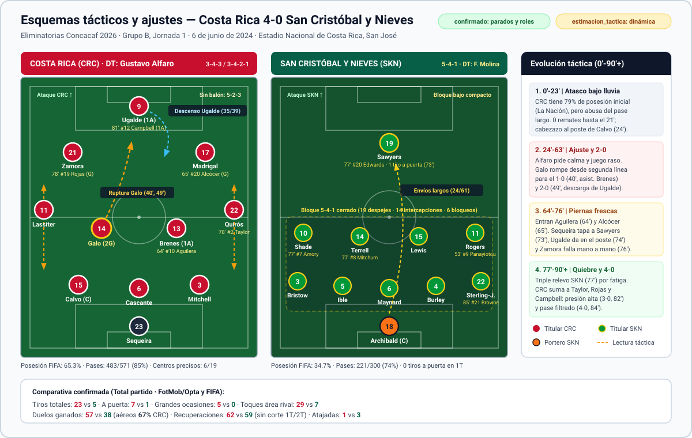
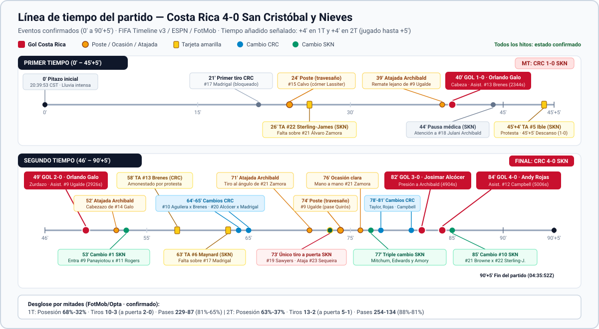
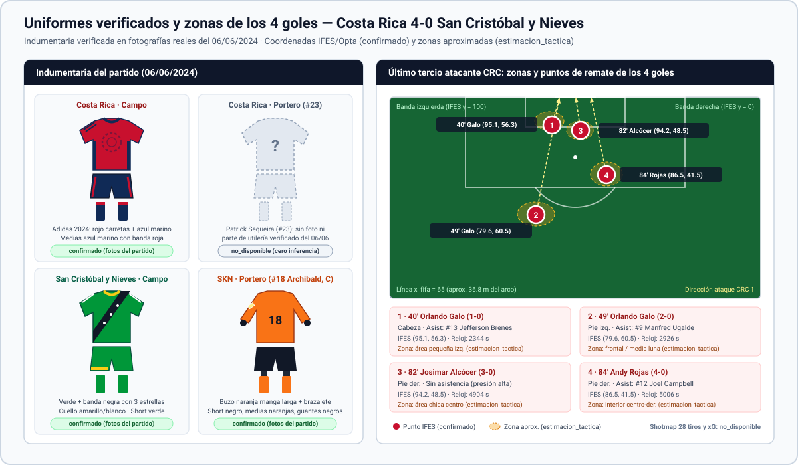

# OMNIMORPH v2 — Costa Rica 4–0 San Cristóbal y Nieves (2024)

Paquete de datos verificados, análisis táctico optimizado para RAG y diagramas vectoriales del encuentro **Costa Rica 4–0 San Cristóbal y Nieves** (Eliminatorias Concacaf rumbo al Mundial 2026, Segunda Ronda, Grupo B, Jornada 1, 6 de junio de 2024 en San José).

Alimenta directamente el chatbot de OMNIMORPH para responder consultas sobre el partido y aplicar filtros posteriores con paridad exacta entre JSON, CSV, narrativa y gráficos.

---

## Resumen Ejecutivo (4–0)

Costa Rica abrió su eliminatoria hacia el Mundial 2026 con un **4–0** bajo lluvia intensa en el Estadio Nacional de La Sabana ante **15,700** aficionados, asumiendo de inmediato el liderato del Grupo B (`3 puntos, +4`).

Ante un bloque `5-4-1` ultracerrado de San Cristóbal y Nieves, Costa Rica dominó el balón desde el arranque (`65.3%` posesión oficial FIFA; `79%` en los primeros 20 minutos según La Nación), pero tardó `21` minutos en rematar por el abuso de envíos largos sobre césped mojado. Tras corregir a circulación rasante y sumar llegadas desde segunda línea, **Orlando Galo** (`#14`) destrabó el partido con un doblete (`40'` de cabeza tras centro de Jefferson Brenes; `49'` de zurda tras pase atrasado de Manfred Ugalde). En el cierre, con la defensa visitante desgastada y tras su triple relevo del `77'`, los ingresos costarricenses liquidaron en dos minutos: **Josimar Alcócer** (`82'`, presión directa sobre el despeje de Julani Archibald) y el debutante **Andy Rojas** (`84'`, pase filtrado de Joel Campbell).

---

## Ficha Rápida del Partido

| Campo | Dato del encuentro | Estado |
| :--- | :--- | :--- |
| **Partido y marcador** | Costa Rica `4–0` San Cristóbal y Nieves (MT `1–0` / 2T `3–0`) | `confirmado` |
| **Competición** | Eliminatorias Concacaf 2026 — Segunda Ronda, Grupo B, J1 | `confirmado` |
| **Fecha y hora real** | 6 de junio de 2024, `20:39:53` CST (`02:39:53Z` del 7 de junio UTC) | `confirmado` |
| **Estadio y asistencia** | Estadio Nacional de Costa Rica (San José) · `15,700` espectadores | `confirmado` |
| **Directores técnicos** | Gustavo Alfaro (CRC) · Francisco Molina (SKN) | `confirmado` |
| **Esquemas iniciales** | CRC `3-4-3` / `3-4-2-1` (sin balón `5-2-3`) · SKN `5-4-1` | `confirmado` |
| **Goles** | Galo (`40'`, `49'`), Alcócer (`82'`), Rojas (`84'`) | `confirmado` |
| **Asistencias** | Brenes (`40'`), Ugalde (`49'`), sin asist. (`82'`), Campbell (`84'`) | `confirmado` |
| **Tarjetas** | 4 amarillas (`26'` Sterling-James, `45'+4'` Ible, `58'` Brenes, `63'` Maynard) · 0 rojas | `confirmado` |
| **Posesión / Tiros / Pases** | FIFA `65.3%–34.7%` · Tiros `23–5` (a puerta `7–1`) · Pases `483/571` vs `221/300` | `confirmado` |
| **Recuperaciones (total)** | `62` CRC (`57` campo + `5` Sequeira) vs `59` SKN (`52` + `7` Archibald) | `confirmado` |
| **Métricas no públicas** | `xG`, `xA`, `km` recorridos, `sprints`, `tracking 25 fps`, mapas de calor, `PPDA`, `shotmap` completo, corte `1T/2T` de recuperaciones, temperatura exacta y color de uniforme de Patrick Sequeira | `no_disponible` |

---

## Guía de Archivos para Ingesta del Chatbot

| Archivo | Rol en el pipeline de OMNIMORPH | Cuándo usarlo |
| :--- | :--- | :--- |
| [ANALISIS_PARTIDO.md](ANALISIS_PARTIDO.md) | **Fuente principal para chunking RAG** | Dividir por bloques `##` / `###` (cada uno repite partido, equipos y fecha). Incluye ficha, alineaciones, goles, tabla `1T/2T/Total`, lectura táctica y lista explícita `no_disponible` para evitar alucinaciones. |
| [datos/ficha_partido.json](datos/ficha_partido.json) | Metadata estructurada del juego | Consultas exactas de horarios UTC/CST, estadio, terna arbitral, uniformes y registro de discrepancias entre portales. |
| [datos/alineaciones.json](datos/alineaciones.json) / [datos/alineaciones.csv](datos/alineaciones.csv) | Planteles completos (`46` convocados) | Filtros por dorsal, titularidad, minutos jugados, posición, rol táctico y cambios. |
| [datos/estadisticas.json](datos/estadisticas.json) / [datos/estadisticas.csv](datos/estadisticas.csv) | Métricas de equipo (`1T`, `2T`, `Total`) y `32` jugadores | Consultas cuantitativas por mitad o jugador (FotMob/Opta + FIFA) y listado formal de campos `no_disponible`. |
| [datos/goles_y_eventos.json](datos/goles_y_eventos.json) / [datos/goles_y_eventos.csv](datos/goles_y_eventos.csv) | Cronología tabular (`30` eventos `0'`–`90'+5'`) | Búsquedas por minuto, reloj en segundos ESPN, coordenadas IFES `(0..100)`, tarjetas, cambios y ocasiones clave. |
| [FUENTES.md](FUENTES.md) | Trazabilidad, citas y URLs oficiales | Auditoría de origen, enlaces oficiales a fotos/planteles (FCRF, Concacaf, FIFA, SKNFA) y explicación de discrepancias interfuentes. |
| [scripts/validate_data.py](scripts/validate_data.py) | Validador de paridad e invariantes | Verificación automática tras cualquier edición antes de indexar o hacer push. |

---

## Diagramas Tácticos y Referencia Visual (`assets/`)

### Esquemas tácticos y evolución del partido


### Línea de tiempo completa (0'–90'+5')


### Uniformes verificados y zonas de los 4 goles


---

## Validación de Datos y Enlaces

El repositorio incluye un validador en Python estándar (sin dependencias externas) que comprueba existencia de archivos, paridad exacta JSON/CSV/Markdown/SVG, invariantes matemáticas (`goles + atajadas_rival <= tiros_a_puerta`, sumas `1T + 2T == Total`, consistencia de `11` titulares y cambios), ausencia de muletillas de IA y validez XML de los gráficos:

```bash
python3 scripts/validate_data.py
```

Para verificar además en vivo que todas las URLs registradas en `FUENTES.md` respondan `HTTP 200`:

```bash
python3 scripts/validate_data.py --check-urls
```
